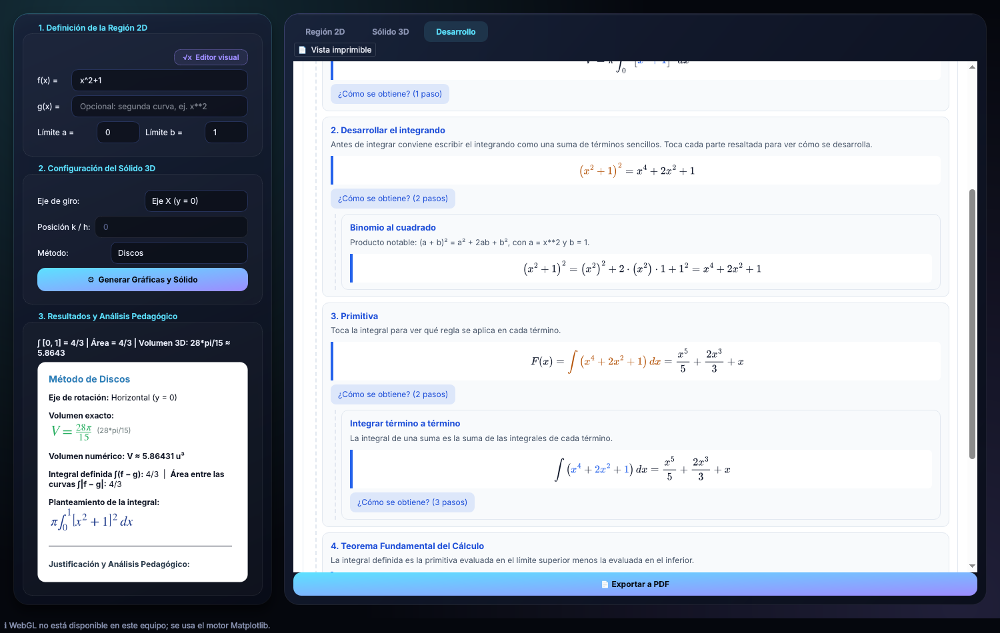

# IntegralLab

Aplicación de escritorio para **cálculo integral simbólico** y **sólidos de revolución**, con una interfaz oscura estilo *glass* y un desarrollo paso a paso pensado para estudiar: cada parte de una fórmula se puede tocar para ver cómo se obtuvo.

## Qué hace

- Introduces `f(x)` (y opcionalmente `g(x)`) o un **conjunto de puntos** `(x, y)` para interpolar (Lagrange con 4 puntos o menos; spline cúbico natural con 5 o más).
- Escribes en texto (`x^2 + 1`, `sen(x)`, `0,5x`, `ln|x|`, `sinx`, `x(x+1)`…) o con el **editor visual** (botón «√x Editor visual»), donde la fracción dibuja su raya y la raíz su signo, como en GeoGebra o en una calculadora Casio.
+ Calcula la **integral definida** `∫(f − g)` y, por separado, el **área entre las curvas** `∫|f − g|` (partida en los cruces): `sin(x)` en [0, 2π] tiene integral 0 y área 4.
- Dibuja la región 2D sombreada y genera el **sólido de revolución** en 3D alrededor del eje X, el eje Y o un eje desplazado (`y = k`, `x = h`), con deslizadores de ángulo, rebanada representativa y cilindros de Riemann.
- Calcula el volumen con **Discos**, **Arandelas** o **Casquillos cilíndricos**. Si el método elegido necesita integrar en `y`, describe la región por **franjas horizontales** con sus bordes reales.
- Muestra el **desarrollo paso a paso** en dos vistas:
  - **Desglose interactivo** (por defecto): al tocar una parte resaltada de una fórmula se despliega, debajo, su desarrollo: de dónde sale un radio, el binomio al cuadrado, la regla de integración de cada término (potencia, sustitución, partes, identidades), la comprobación derivando la primitiva (regla de la cadena y del producto) y la evaluación con el Teorema Fundamental del Cálculo.
  - **Vista imprimible**: los 7 pasos clásicos, que se exportan a **PDF**.
- Dibuja la región 2D sombreada entre las curvas.
- Genera el **sólido de revolución** en 3D alrededor del eje X, el eje Y o un eje desplazado (`y = k`, `x = h`).
- Calcula el volumen con **Discos**, **Arandelas** o **Casquillos cilíndricos**, con **despeje analítico automático a dy** cuando el método lo requiere.
- Muestra el **desarrollo analítico paso a paso** con fórmulas LaTeX renderizadas y lo exporta a **PDF**.

### Qué método admite cada eje



### Qué método admite cada eje

| Eje de giro | Discos / Arandelas | Casquillos |
|---|---|---|
| Horizontal (`y = 0` o `y = k`) | Directo (cortes en dx) | Por franjas horizontales (dy) |
| Vertical (`x = 0` o `x = h`) | Por franjas horizontales (dy) | Directo (cortes en dx) |

Para integrar en `dy`, cada borde curvo de una franja se despeja con SymPy. Si una curva no tiene una rama real despejable, el método aparece deshabilitado en el selector (para polinomios de grado ≤ 4 se comprueba al elegir el eje) o el cálculo lo explica y sugiere el método directo. Todo volumen se contrasta con una cuadratura numérica independiente: un desarrollo que no coincide no se muestra como resultado.

Si el eje atraviesa el interior de la región, el cálculo se rechaza con una explicación (los dos lados se solaparían al girar).

## Instalación y uso

Requiere Python 3.10 o superior (el proyecto se desarrolla con 3.14).

```bash
python -m venv .venv
source .venv/bin/activate        # En Windows: .venv\Scripts\activate
pip install -e ".[dev]"
python -m integrallab
```

Para ejecutar las pruebas:

```bash
pytest
```

## Stack

| Rol | Tecnología |
|---|---|
| Interfaz de escritorio | PySide6 (Qt) |
| Cálculo simbólico | SymPy |
| Visualización 2D y 3D | Matplotlib (integrado en Qt) y Three.js (WebGL, QtWebEngine) |
| Editor visual de fórmulas | MathLive (MIT), sin conexión, en QtWebEngine |
| Tests | pytest |

## Estructura

```
integrallab/
├── core/       Dominio matemático puro: parser, editor visual (LaTeX → texto), integrales, muestreo y sólidos
├── ui/         Interfaz PySide6: ventana principal, proceso de cálculo, tema glass/dark y widgets
│   └── widgets/
├── viz/        Lienzos Matplotlib 2D/3D, visor Three.js y renderizado de LaTeX
└── resources/  Three.js, MathLive y las páginas locales del visor 3D y del editor visual
tests/          Pruebas con pytest
docs/           Arquitectura, estado, auditoría, decisiones, privacidad y registro de sesiones
```

La regla de arquitectura es que la UI nunca habla con SymPy directamente: todo pasa por `integrallab.core`. Detalles en `AGENTS.md` y `docs/ARQUITECTURA.md`.

## Documentación

El índice y el orden de lectura están en [`docs/README.md`](docs/README.md). Los más usados:

- [`docs/ARQUITECTURA.md`](docs/ARQUITECTURA.md): cómo encajan los módulos.
- [`docs/EDITOR_VISUAL.md`](docs/EDITOR_VISUAL.md): uso y diseño del editor visual de fórmulas.
- [`docs/AUDITORIA_2026-10-24.md`](docs/AUDITORIA_2026-10-24.md): bugs conocidos y plan de corrección.
- [`docs/PRIVACIDAD.md`](docs/PRIVACIDAD.md): qué datos no entran al repositorio.
- [`THIRD_PARTY_NOTICES.md`](THIRD_PARTY_NOTICES.md): componentes de terceros y sus licencias.

## Estado del proyecto

Ver `docs/PROJECT_STATUS.md` para el detalle por fases.

- ✅ Fases 1–11.2: núcleo matemático, visualización 2D/3D, desarrollo paso a paso, exportación a PDF y rediseño *glass/dark*.
- ✅ Fase 12: interpolación numérica (Lagrange, Newton, splines cúbicos), entrada de puntos discretos, visor 3D Three.js acelerado por WebGL y blindaje de seguridad matemática (174 pruebas pasando al 100%).
- ✅ Editor visual de fórmulas (estilo GeoGebra / calculadora Casio) y documentación completa con comprobación automática de privacidad (413 pruebas pasando; 1 se omite si no se define `INTEGRALLAB_PRIVATE_TERMS`).
- ⏳ Pendiente: corregir los hallazgos de la auditoría del 2026-10-24 (`docs/AUDITORIA_2026-10-24.md`).
- ⏳ Pendiente: conectar el panel de IA (`ChatPanel`), que hoy no tiene backend.

## Derechos de autor

IntegralLab es un proyecto de software desarrollado por **Johan Stiven Lasso Aguirre**.

**© 2026 Johan Stiven Lasso Aguirre. Todos los derechos reservados.**

El código original y la documentación propia están sujetos a los derechos de autor aplicables. No se autoriza su reutilización, modificación o distribución sin el permiso correspondiente, salvo en los casos permitidos por la legislación aplicable. Los componentes de terceros conservan sus respectivas licencias.

Para consultar el alcance del aviso de autoría y las condiciones de uso, revisa [`COPYRIGHT.md`](COPYRIGHT.md) y [`LICENSE`](LICENSE). Este aviso no equivale a un registro ante la DNDA.

