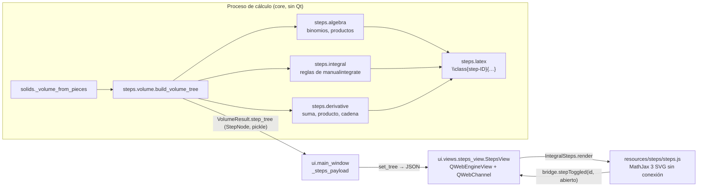

# Desglose interactivo del desarrollo («estilo Photomath»)

La pestaña **Desarrollo** muestra el cálculo como un árbol de pasos: al tocar una parte resaltada de una fórmula se despliega, justo debajo, el paso que explica cómo se obtuvo, y ese paso puede tener a su vez partes resaltadas. Este documento explica cómo se usa, cómo está construido y cómo mantenerlo.

## Uso

1. Calcule un sólido como siempre y abra la pestaña **Desarrollo**.
2. Las partes de color azul son clicables (también con el teclado: Tab y Enter). Al tocarlas se despliega su paso y se vuelven naranja; al tocarlas otra vez se pliega.
3. **¿Cómo se obtiene? (n pasos)** despliega todos los subpasos de una tarjeta. **Desplegar todo** y **Plegar todo** actúan sobre el árbol completo.
4. El botón **📄 Vista imprimible** cambia a la vista clásica de 7 pasos, que es la que se exporta a PDF. **🔎 Desglose interactivo** vuelve. La elección se recuerda (`QSettings`, clave `results/interactive_steps`).

Qué se puede desplegar, por ejemplo, en `f(x) = x² + 1` girando alrededor del eje X:

| Tarjeta | Parte clicable | Se despliega |
| --- | --- | --- |
| Planteamiento | `[x² + 1]²` | De dónde sale el radio R(x) (distancia de la curva al eje, con su signo) |
| Desarrollar el integrando | `(x² + 1)²` | Binomio al cuadrado: `(a + b)² = a² + 2ab + b²` con a y b concretos |
| Primitiva | `∫(x⁴ + 2x² + 1) dx` | Integrar término a término → cada término con la regla de la potencia |
| Comprobación | `d/dx [F]` | La derivada de F con su regla (suma, producto, cadena) |
| Teorema Fundamental | `F(1)`, `F(0)` | Cada evaluación |
| Resultado (por tramos) | `V₁`, `V₂` | El tramo correspondiente |

Con inversión a `dy` (por ejemplo, Discos alrededor del eje Y) aparece primero **Despejar x en función de y**, con cada franja horizontal y sus bordes reales.

## Arquitectura

### 1. Modelo: `integrallab/core/steps/`

| Módulo | Contenido |
| --- | --- |
| `model.py` | `StepNode(id, rule, title, explanation, latex, children)` inmutable; `IdGenerator` (ids `s1`, `s2`…; tope `MAX_TREE_NODES = 400`); `class_targets(latex)`. |
| `latex.py` | `TaggingLatexPrinter`: subclase del impresor LaTeX de SymPy que envuelve en `\class{step-ID}{…}` las subexpresiones marcadas. Reconoce la subexpresión por su árbol, no por su texto. Solo marca subexpresiones que aparecen una vez (en `x·eˣ` la `x` del exponente no abre el paso de «u = x»). |
| `integral.py` | Convierte el árbol de reglas de `sympy.integrals.manualintegrate.integral_steps` en `StepNode`: suma, constante, potencia, sustitución (cambio de variable, despeje de x, integral en u, vuelta a x), partes (elección de u y dv, cálculo de v, fórmula), partes cíclicas (reconstruidas a mano: SymPy deja sus integrandos en `None`), identidades, sustitución trigonométrica. `describe_technique` resume la técnica principal (una sustitución lineal como u = 2x no cuenta como técnica). `antiderivative` devuelve la misma primitiva que muestra el árbol. |
| `derivative.py` | Árbol de `d/dx`: constante, variable, suma, constante por función, cociente, producto, potencia, cadena (potencia, función elemental, exponencial de base constante), derivación logarítmica, valor absoluto. Se usa en la **Comprobación**: derivar F devuelve el integrando. |
| `algebra.py` | Binomio al cuadrado y al cubo (con a y b concretos), cuadrado de un polinomio, distributiva, reducción de términos semejantes; factorización (factor común y factores). |
| `volume.py` | `build_volume_tree`: raíz «Desarrollo del volumen» con Planteamiento (radios), Desarrollar el integrando, Primitiva (+ Comprobación), Teorema Fundamental y Resultado; un nodo por tramo cuando hay cruces o franjas. |

Rigor que comprueban las pruebas (`tests/test_steps_tree.py`):

- Toda ancla `\class{step-ID}` apunta a un nodo que existe en el árbol.
- Ningún paso contiene `Integral(` ni `re(`.
- La primitiva del árbol, derivada, devuelve el integrando; la regla raíz es la de un libro (producto, cadena, cociente, partes, sustitución, identidad).
- El árbol se puede serializar con `pickle` (viaja por la tubería del proceso de cálculo).

### 2. Vista: `integrallab/ui/views/steps_view.py`

`StepsView` es un `QWidget` con un `QWebEngineView` que carga `resources/steps/index.html`:

- **Python → JavaScript.** `set_tree(tree, title=…, meta=…)` serializa `tree.to_dict()` con `json.dumps` y llama `IntegralSteps.render(payload)`. Si la página o MathJax aún no están listos, el árbol queda pendiente y se envía al recibir `ready`.
- **JavaScript → Python.** Objeto `bridge` publicado por `QWebChannel`: `ready()`, `rendered(n)` y `stepToggled(id, abierto)`, que se reexpone como la señal `StepsView.stepToggled`.
- **Seguridad.** La página solo navega dentro de `integrallab/resources/` (`_LocalPage.acceptNavigationRequest`); tiene una política de contenido sin red; títulos y explicaciones se insertan con `textContent` (nunca `innerHTML`); MathJax corre sin menú contextual. El LaTeX lo produce SymPy en el dominio, no el usuario.
- **Fallo.** Sin QtWebEngine o sin los archivos, `steps_view_support()` lo indica y la ventana usa la vista imprimible; si MathJax no carga en 20 s, `loadFailed` hace lo mismo y se avisa en la barra de estado.

`MainWindow` crea la vista la primera vez que se abre la pestaña con el modo interactivo activo (QtWebEngine tarda en arrancar) y le pasa el último árbol (`_steps_payload`). Los mensajes de error o cancelación llegan a las dos vistas (`_set_steps_message`).

### 3. Página: `integrallab/resources/steps/`

| Archivo | Papel |
| --- | --- |
| `index.html` | Configuración de MathJax (`tex.packages: ["html"]` para `\class`, `svg.fontCache: "local"`, `enableMenu: false`, `typeset: false`) y carga de `../mathjax/tex-svg-full.js` y `qrc:///qtwebchannel/qwebchannel.js`. |
| `steps.js` | Lógica de eventos: índice id → nodo y id → padre; tarjetas construidas al primer despliegue (perezoso); `MathJax.tex2svgPromise` por fórmula; cada `<g class="step-ID">` del SVG se marca como botón (`tabindex`, `role`, `aria-label`, `<title>`); clic o Enter alternan el paso; si el paso vive en otra tarjeta (V₁ en el resultado) se abre allí, se desplaza la vista y se resalta. |
| `steps.css` | Mismos colores que la vista imprimible; partes clicables en azul, abiertas en naranja. |

Dos detalles de MathJax que costaron un error cada uno:

- `tex2svgPromise` no inserta la hoja de estilos de la salida SVG: sin `MathJax.svgStylesheet()` se ve el MathML de accesibilidad como texto duplicado. `IntegralSteps.mathReady` la añade.
- Con `fontCache: "global"` los glifos quedan en una caché que `tex2svgPromise` no adjunta al documento y la fórmula se ve vacía (solo las rayas de fracción). Se usa `"local"`.

## Pruebas

- `tests/test_steps_tree.py`: rigor del árbol (anclas, primitivas, reglas, técnicas de los 11 integrandos de la auditoría, binomios, factorización, tope de nodos, desarrollo de 10 volúmenes).
- `tests/test_steps_view.py`: la página carga MathJax sin conexión; un clic en `R(x)` despliega su paso y llega a Python por `QWebChannel`; otro clic lo pliega; `reveal` abre un paso profundo con sus antepasados; el texto con `` no se interpreta como HTML; la ventana crea la vista al abrir la pestaña y permite volver a la imprimible.

## Mantenimiento

- **Añadir una regla de integración o derivación:** un caso en `_texts` y en `_node` (`integral.py`) o en `_node` (`derivative.py`), con su prueba en `tests/test_steps_tree.py`. Marcar con `tags[subexpresión] = hijo.id` la parte de la fórmula que el hijo explica.
- **Actualizar MathJax:** reemplazar `integrallab/resources/mathjax/tex-svg-full.js` y `LICENSE_MATHJAX.txt` por los del paquete `mathjax` de npm (carpeta `es5/`), cambiar la versión en `THIRD_PARTY_NOTICES.md` y pasar `tests/test_steps_view.py`.
- **Límites:** integrandos con `Piecewise` (splines) o más de 250 operaciones no se desglosan (se muestra la primitiva con una nota); árboles de más de 400 nodos se resumen.
