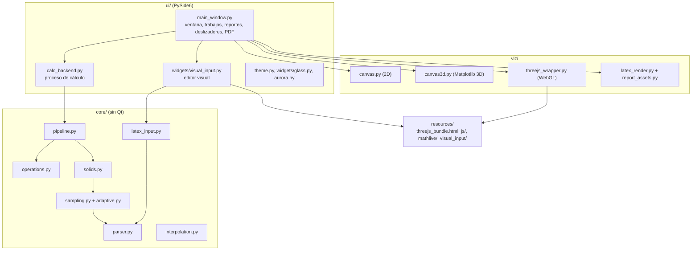
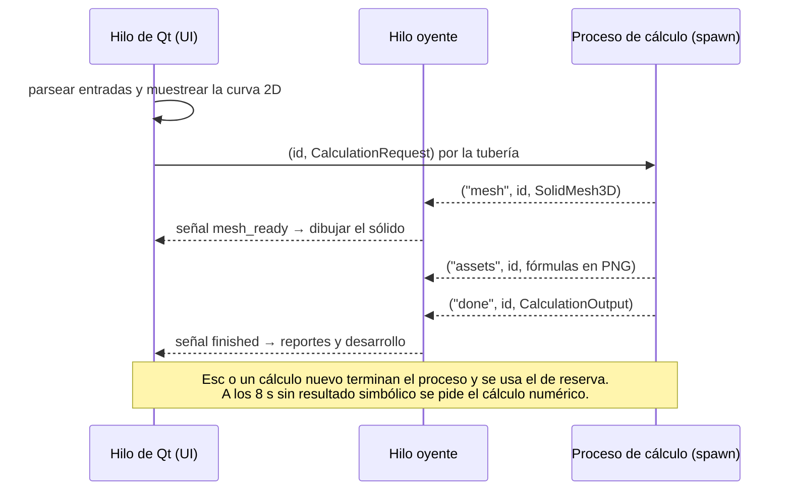

# Arquitectura de IntegralLab

IntegralLab es una aplicación de escritorio en Python (PySide6) con tres capas: `core` (matemática pura con SymPy y NumPy), `viz` (lienzos Matplotlib y visor Three.js) y `ui` (ventana, orquestación y widgets). Los cálculos simbólicos corren en un proceso aparte para que la interfaz no se congele. Este documento describe el código tal como está; las deudas conocidas están en [`AUDITORIA_2026-10-24.md`](AUDITORIA_2026-10-24.md).

## Capas y dependencias

Reglas de dependencia (ver `AGENTS.md` y `docs/TECHNICAL_DECISIONS.md`, D1 y D2):

- `core` no importa Qt ni Matplotlib.
- `viz` recibe datos numéricos (`CurveData`, `SolidMesh3D`) y no hace cálculo simbólico.
- `ui` no debería usar SymPy directamente. Hoy hay excepciones documentadas en la auditoría (hallazgo M2).

## Módulos

| Módulo | Líneas | Responsabilidad |
| --- | --- | --- |
| `__main__.py` | 46 | Punto de entrada: `QApplication`, tema y `MainWindow`. |
| `core/parser.py` | 761 | Parser seguro: lista blanca de funciones, validación del árbol sintáctico, límites de tamaño, normalizador es-CO (`sen`, `0,5`, `√`, `\|x\|`) y detección de listas de puntos. |
| `core/latex_input.py` | 657 | Traducción entre el LaTeX del editor visual y el texto del parser. |
| `core/operations.py` | 287 | Integral definida (con validación de dominio y convergencia), derivada e integral indefinida (estas dos sin uso en la interfaz). |
| `core/sampling.py` | 217 | Muestreo de curvas 2D con raíces impares reales. |
| `core/adaptive.py` | 306 | Muestreo adaptativo (refinamiento por píxeles y ángulos, cortes en asíntotas) y nodos repartidos por longitud de arco. |
| `core/interpolation.py` | 516 | Lagrange, Newton y splines cúbicos naturales. |
| `core/solids.py` | 2617 | Volúmenes por discos, arandelas y casquillos; inversión a `dy`; cruces de curvas; recomendación de método; pasos pedagógicos; mallas 3D. |
| `core/pipeline.py` | 295 | Única ruta de cálculo: dominio → eje → malla → área → recomendación → volumen; bucle del proceso de cálculo. |
| `ui/main_window.py` | 1848 | Ventana principal, trabajos de cálculo, reportes HTML, deslizadores 3D, exportación a PDF y editor visual. |
| `ui/calc_backend.py` | 269 | Proceso de cálculo (`spawn`) con un proceso de reserva, cancelación real y reciclado cada 60 trabajos. |
| `ui/theme.py` | 163 | Tokens de color y hoja de estilos QSS (única fuente de verdad visual). |
| `ui/widgets/visual_input.py` | 266 | Editor visual de fórmulas (MathLive en `QWebEngineView`). |
| `ui/widgets/chat_panel.py`, `ai_pulse.py` | 566 | Panel de IA con tarjetas de pasos; sin conectar a ninguna pantalla. |
| `viz/canvas.py` | 485 | Lienzo 2D con brillo, sombreado de la región, tooltip y revelado. |
| `viz/canvas3d.py` | 355 | Sólido en Matplotlib 3D (respaldo cuando no hay WebGL). |
| `viz/threejs_wrapper.py` | 402 | Visor Three.js: malla en float32/base64, saludo de WebGL y paso automático a Matplotlib. |
| `viz/latex_render.py`, `report_assets.py` | 334 | Fórmulas de los reportes a PNG con MathText; pre-renderizado en el proceso de cálculo. |

`integrallab/viz/experimental/` contiene el prototipo de Three.js; se excluye del paquete (`pyproject.toml`).

## Modelo de procesos

- Cada trabajo tiene un identificador; los resultados de trabajos cancelados o reemplazados se descartan.
- Si no se puede crear el proceso, el trabajo corre en un hilo *daemon* (`CalculationWorker`); las pruebas usan el modo síncrono (`_synchronous = True`).
- El proceso de cálculo termina solo si la interfaz muere (vigía del padre y `PR_SET_PDEATHSIG` en Linux).

## Flujo de un cálculo

1. **Entrada.** Texto en las `QLineEdit` o editor visual (que escribe en ellas). Una lista de puntos se interpola: Lagrange con 4 puntos o menos, spline con 5 o más.
2. **Gráfica 2D** en el hilo de Qt con muestreo adaptativo.
3. **Proceso de cálculo** (`pipeline.run_calculation`): símbolos libres, dominio real, eje que atraviesa la región, malla 3D (se envía antes del volumen), integral definida, recomendación de método y volumen con sus pasos.
4. **Presentación:** región sombreada, sólido en los dos motores, tarjeta de resultados y pestaña «Desarrollo» (HTML con fórmulas PNG, exportable a PDF).

## Motores 3D

| | Three.js (`resources/threejs_bundle.html`) | Matplotlib (`viz/canvas3d.py`) |
| --- | --- | --- |
| Papel | Principal | Respaldo sin WebGL |
| Comunicación | `runJavaScript` con la malla en float32/base64 | Llamada directa |
| Tapas del sólido | Sí (construidas en JavaScript) | No |
| Eje vertical de la escena | Y | Z |

Los deslizadores (ángulo θ, rebanada representativa y cilindros de Riemann) regeneran la malla en el hilo de Qt y la envían a los dos motores. La auditoría mide su costo y propone el rediseño (sección «Fase 3»).

## Seguridad

- **Entradas:** todo pasa por `parse_math_expression` (lista blanca, sin atributos, sin índices, sin `__`, límites de exponentes y longitud). El editor visual solo produce texto que luego valida ese parser.
- **Páginas web locales:** el visor Three.js y el editor visual cargan archivos del paquete; no hay peticiones de red. Los datos hacia JavaScript se serializan con JSON (con `<` y `>` escapados) o viajan por `QWebChannel`.
- **Privacidad del repositorio:** ver [`PRIVACIDAD.md`](PRIVACIDAD.md) y `tests/test_privacy.py`.

## Pruebas

| Archivo | Cubre |
| --- | --- |
| `test_parser.py`, `test_core_audit.py` | Parser seguro y regresiones del núcleo |
| `test_operations.py`, `test_sampling.py`, `test_adaptive.py`, `test_interpolation.py` | Operaciones, muestreo e interpolación |
| `test_solids.py`, `test_round3_audit.py` | Volúmenes, cruces, dominio y mallas |
| `test_canvas*.py`, `test_threejs.py`, `test_latex_render.py`, `test_viz_audit.py`, `test_theme.py` | Visualización y tema |
| `test_ui.py`, `test_ui_audit.py` | Ventana principal, trabajos y proceso de cálculo |
| `test_latex_input.py`, `test_visual_input.py` | Editor visual |
| `test_privacy.py` | Que no haya correos, rutas personales ni cuentas en los archivos |
| `test_smoke.py` | Importaciones básicas |

`tests/conftest.py` redirige `QSettings` a una carpeta temporal durante las pruebas.
