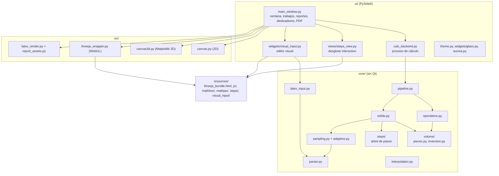
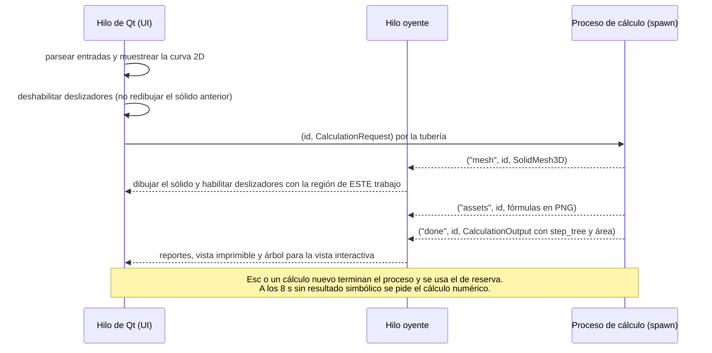

# Arquitectura de IntegralLab

IntegralLab es una aplicación de escritorio en Python (PySide6) con tres capas: `core` (matemática pura con SymPy y NumPy), `viz` (lienzos Matplotlib y visor Three.js) y `ui` (ventana, orquestación, vistas y widgets). Los cálculos simbólicos corren en un proceso aparte para que la interfaz no se congele. Este documento describe el código tal como está tras la auditoría del 2026-10-27 ([`AUDITORIA_2026-10-27.md`](AUDITORIA_2026-10-27.md)); lo que sigue pendiente está en [`PROJECT_STATUS.md`](PROJECT_STATUS.md).

## Capas y dependencias

Reglas de dependencia (ver `AGENTS.md` y `docs/TECHNICAL_DECISIONS.md`, D1, D2 y D8):

- `core` no importa Qt ni Matplotlib. `core/steps` y `core/volume` tampoco importan `core/solids` (que los usa).
- `viz` recibe datos numéricos (`CurveData`, `SolidMesh3D`) y no hace cálculo simbólico.
- `ui` no debería usar SymPy directamente. `views/steps_view.py` recibe `StepNode` (solo cadenas) y no importa el dominio en tiempo de ejecución. Siguen las excepciones de `main_window.py` descritas en la auditoría (hallazgo M2).

## Módulos

| Módulo | Líneas | Responsabilidad |
| --- | --- | --- |
| `__main__.py` | 55 | Punto de entrada: `QApplication`, tema y `MainWindow`; `run()` para el comando `integrallab`. |
| `core/parser.py` | 855 | Parser seguro: lista blanca, validación del árbol sintáctico, límites de tamaño, normalizador es-CO (`sen`, `0,5`, `√`, `\|x\|` anidados), nombres pegados (`sinx`, `xsin(x)`), `x(x+1)` como producto y detección de listas de puntos. |
| `core/latex_input.py` | 657 | Traducción entre el LaTeX del editor visual y el texto del parser. |
| `core/operations.py` | 363 | Integral definida con la rama real de las raíces impares (`∛x`), área entre curvas `∫\|f − g\|` partida en los cruces, derivada e integral indefinida. |
| `core/sampling.py` | 217 | Muestreo de curvas 2D con raíces impares reales. |
| `core/adaptive.py` | 306 | Muestreo adaptativo y nodos repartidos por longitud de arco. |
| `core/interpolation.py` | 516 | Lagrange, Newton y splines cúbicos naturales. |
| `core/solids.py` | 1935 | Tipos (`Region2D`, `VolumeResult`, `SolidMesh3D`…), cruces, tramos de Discos/Arandelas/Casquillos con radios de signo resuelto, inversión a `dy` por franjas, desarrollo de 7 pasos, red de seguridad contra la cuadratura, recomendación de método y mallas (`solid_profile` + `revolve_profile`). |
| `core/volume/pieces.py` | 210 | Puntos donde cambia el signo de `\|u\|`, de una raíz impar o de una distancia al eje; rama real por tramo (`real_branch`) y forma real para la cuadratura (`real_root_form`). |
| `core/volume/inversion.py` | 277 | Franjas horizontales: valores críticos de `y`, sección real de cada franja, bordes (rectas o ramas despejadas). |
| `core/steps/` | 1159 | Árbol de pasos del desglose interactivo (ver [`DESGLOSE_INTERACTIVO.md`](DESGLOSE_INTERACTIVO.md)). |
| `core/pipeline.py` | 315 | Única ruta de cálculo: dominio → eje → malla → integral y área → recomendación → volumen; `sanitize_mesh`; bucle del proceso de cálculo. |
| `ui/main_window.py` | 2014 | Ventana principal, trabajos, reportes HTML, pestaña Desarrollo (interactiva o imprimible), deslizadores 3D agrupados por cuadro, PDF y editor visual. |
| `ui/views/steps_view.py` | 220 | `StepsView`: `QWebEngineView` + `QWebChannel` con MathJax 3 sin conexión. |
| `ui/calc_backend.py` | 269 | Proceso de cálculo (`spawn`) con un proceso de reserva, cancelación real y reciclado cada 60 trabajos. |
| `ui/theme.py` | 163 | Tokens de color y hoja de estilos QSS. |
| `ui/widgets/visual_input.py` | 266 | Editor visual de fórmulas (MathLive en `QWebEngineView`). |
| `ui/widgets/chat_panel.py`, `ai_pulse.py` | 566 | Panel de IA con tarjetas de pasos; sin conectar (hallazgo M11). |
| `viz/canvas.py` | 485 | Lienzo 2D. |
| `viz/canvas3d.py` | 382 | Sólido en Matplotlib 3D; `keep_camera` para los cuadros de los deslizadores. |
| `viz/threejs_wrapper.py` | 448 | Visor Three.js: malla en float32/base64, control de vuelo (un envío a la vez), saludo de WebGL y paso a Matplotlib solo si el visor deja de responder. |
| `viz/latex_render.py`, `report_assets.py` | 334 | Fórmulas de la vista imprimible y del PDF a PNG con MathText. |

### Código heredado sin uso

Los módulos `core/domain/`, `core/migration.py`, `core/mesh.py`, `core/volume/calculation.py`, `core/volume/meshing/`, `legacy_compat/`, `ui/photomath/`, `ui/controllers/`, `resources/js/qwebchannel_bridge.js`, `integrallab/tests/` y `scratch/` no se importan desde la aplicación y varios no se pueden importar (errores de sintaxis o de nombres). La auditoría del 2026-10-27 los detalla; el parche opcional `integrallab-limpieza.patch` los retira. No construir sobre ellos.

## Modelo de procesos

## Flujo de un cálculo

1. **Entrada.** Texto en las `QLineEdit` (f(x) admite hasta 20 000 caracteres por las listas de puntos; las demás, la longitud del parser) o editor visual. Una lista de puntos se interpola.
2. **Gráfica 2D** en el hilo de Qt.
3. **Proceso de cálculo** (`pipeline.run_calculation`): símbolos libres, dominio real, eje que atraviesa la región, malla 3D (se envía antes), integral definida `∫(f − g)` y área `∫|f − g|`, recomendación y volumen.
4. **Volumen** (`solids.calculate_revolution_volume`):
   - Método directo: se parte `[a, b]` en los cruces, en los puntos de igual distancia al eje y donde cambia el signo de una distancia, de un `|u|` o de la base de una raíz impar; en cada tramo los radios se escriben sin valor absoluto (`f − k` o `k − f`, `x − h` o `h − x`) y con la rama real.
   - Inversión a `dy` (Discos/Arandelas con eje vertical, Casquillos con eje horizontal): `core/volume/inversion.py` describe la región por franjas horizontales con sus bordes reales.
   - Cada tramo se integra, se arma el desarrollo de 7 pasos (o por tramos) y el árbol interactivo, y el total se contrasta con la cuadratura independiente `numeric_volume`.
5. **Presentación:** región sombreada, sólido, tarjeta de resultados (integral, área y volumen) y pestaña Desarrollo.

## Desglose interactivo

Ver [`DESGLOSE_INTERACTIVO.md`](DESGLOSE_INTERACTIVO.md). En resumen: el dominio produce un árbol de `StepNode` con fórmulas LaTeX cuyas partes explicables van en `\class{step-ID}{…}`; la vista lo muestra con MathJax 3 (SVG, sin conexión) y cada parte marcada despliega su paso.

## Motores 3D y deslizadores

| | Three.js (`resources/threejs_bundle.html`) | Matplotlib (`viz/canvas3d.py`) |
| --- | --- | --- |
| Papel | Principal | Respaldo sin WebGL |
| Comunicación | `runJavaScript`, un envío en vuelo a la vez | Llamada directa |
| Cámara en los deslizadores | Se conserva (`fit_camera: false`, sin reactivar el giro) | Se conserva (`keep_camera=True`: elevación, azimut, zoom y límites) |
| Eje vertical de la escena | Y | Z |

Los deslizadores (ángulo θ, rebanada y cilindros de Riemann) piden un cuadro; un temporizador de 16 ms dibuja solo el último estado y solo en el motor visible. El perfil del sólido se muestrea una vez por resultado (`solid_profile`) y cada ángulo es un giro en NumPy (`revolve_profile`). Medido en este entorno: 0,3 ms de Python por cuadro con WebGL y 12,6 ms con Matplotlib (antes 31 y 26 ms por evento, sin agrupar y en los dos motores).

## Seguridad

- **Entradas:** todo pasa por `parse_math_expression`. El editor visual solo produce texto que valida ese parser.
- **Páginas web locales:** visor Three.js, editor visual y desglose cargan archivos del paquete; el desglose bloquea toda navegación fuera de `resources/` y declara una política de contenido sin red. Los datos hacia JavaScript viajan como JSON o por `QWebChannel`; el texto se inserta con `textContent`.
- **Privacidad del repositorio:** ver [`PRIVACIDAD.md`](PRIVACIDAD.md) y `tests/test_privacy.py`.

## Pruebas

| Archivo | Cubre |
| --- | --- |
| `test_parser.py`, `test_core_audit.py` | Parser seguro, entradas de estudiantes y regresiones del núcleo |
| `test_operations.py`, `test_sampling.py`, `test_adaptive.py`, `test_interpolation.py` | Operaciones, muestreo e interpolación |
| `test_solids.py`, `test_round3_audit.py`, `test_audit_phase0.py` | Volúmenes, cruces, dominio, mallas y red de seguridad |
| `test_volume_inversion.py` | Inversión por franjas, tramos de signo, integral frente a área; cada volumen contra su forma cerrada y contra la cuadratura |
| `test_steps_tree.py` | Rigor del árbol de pasos |
| `test_steps_view.py` | Desglose interactivo en QtWebEngine (clic, `QWebChannel`, texto seguro, integración en la ventana) |
| `test_sliders.py` | Agrupación por cuadro, motor visible, cámara, rapidez y malla saneada |
| `test_canvas*.py`, `test_threejs.py`, `test_latex_render.py`, `test_viz_audit.py`, `test_theme.py` | Visualización y tema |
| `test_ui.py`, `test_ui_audit.py` | Ventana principal, trabajos y proceso de cálculo |
| `test_latex_input.py`, `test_visual_input.py` | Editor visual |
| `test_privacy.py` | Que no haya correos, rutas personales ni cuentas en los archivos |
| `test_smoke.py` | Importaciones básicas |

`tests/conftest.py` redirige `QSettings` a una carpeta temporal durante las pruebas. `integrallab/tests/` no forma parte de la suite (`testpaths = ["tests"]`) y sus pruebas no se pueden importar.
