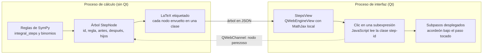

# Auditoría técnica de IntegralLab

**Fecha:** 24 de octubre de 2026 · **Código auditado:** commit `adcedc7` · **Estado de los hallazgos:** pendientes de aplicar

> **Cómo leer este documento.** Es una fotografía del código en el commit `adcedc7`: los números de línea citados corresponden a esa versión (después del parche del editor visual, `ui/main_window.py` se desplazó; busque por nombre de función). Ningún hallazgo de severidad alta o media está corregido todavía, salvo lo indicado en «Relación con el editor visual» al final. Cuando se corrija uno, anótelo en `docs/PROJECT_STATUS.md` con su identificador (A1–A8, M1–M13).
>
> La auditoría se hizo con asistencia de IA (Claude, de Anthropic) a pedido del autor del proyecto; cada hallazgo se reprodujo ejecutando el código.

## Alcance y método

Se auditó el commit `adcedc7` de IntegralLab (64 archivos, unas 8.000 líneas de Python) leyendo todo el código y ejecutándolo: la suite propia pasa completa (303 pruebas en Python 3.13, SymPy 1.14, NumPy 2.5, PySide6 6.12, en modo sin pantalla). Cada hallazgo de este informe se reprodujo con una sonda ejecutable; los volúmenes se contrastaron con la cuadratura mpmath de la propia app, que no pasa por la inversión, y con el cálculo a mano de cada caso de la tabla A1.

Varios supuestos del encargo no coinciden con el repositorio real. La auditoría evalúa lo que existe y marca lo que falta:

| Supuesto del encargo | Realidad en el código |
| --- | --- |
| Cálculo paso a paso diferencial e integral | Solo integral definida y volúmenes de revolución. `differentiate()` existe en `core/operations.py` pero ninguna pantalla lo usa. |
| PyQt o Tkinter | PySide6 (Qt 6). |
| MathJax offline | No hay MathJax. Las fórmulas son PNG rasterizados con Matplotlib MathText (`viz/latex_render.py`) dentro de un `QTextEdit`. |
| Dos motores 3D | Matplotlib `mplot3d` (`viz/canvas3d.py`) y Three.js r160 (2023) sobre `QWebEngineView` (`viz/threejs_wrapper.py` + `resources/threejs_bundle.html`). |
| Desglose interactivo al hacer clic en la ecuación | No existe. Los pasos son una lista fija de 7 plantillas de texto, sin árbol ni enlaces. |

Aviso de entorno: como root en un contenedor, la suite aborta en la primera prueba que crea `MainWindow` porque Chromium exige sandbox; pasa con `QTWEBENGINE_DISABLE_SANDBOX=1` y `--no-sandbox --disable-gpu`. Conviene fijarlo en la CI.

## Resumen ejecutivo

Veredicto: la base de ingeniería es sólida (proceso de cálculo aislado, cancelación real, parser con lista blanca, 303 pruebas), pero el producto no es todavía confiable para enseñar. Tres fallas lo impiden: volúmenes erróneos reportados como éxito, un desarrollo paso a paso que se rompe en casi todos los casos de casquillos, y la ausencia total de interactividad en las ecuaciones.

- **Exactitud matemática.** En 9 de 12 casos probados con inversión a `dy` (Discos o Arandelas con eje vertical, Casquillos con eje horizontal) el volumen sale mal y se muestra como correcto. Ejemplo: `x³` en \[0, 1\] alrededor del eje Y por Discos da 3π/5 en vez de 2π/5. La interfaz habilita esos métodos con el texto «Aplica invirtiendo analíticamente».
- **Paso a paso.** En 6 de 9 casos de prueba los pasos muestran `Integral(x**2*Abs(x), x)` como «primitiva», o artefactos como `exp(re(x))`. Fallan los 4 casquillos sin cruces probados, incluido el ejemplo de libro `x²` en \[0, 1\] alrededor del eje Y. El clasificador de técnicas acierta 4 de 11 integrandos.
- **Interactividad estilo Photomath: hallazgo crítico.** No hay MathJax, no hay árbol de pasos y no se puede hacer clic en ninguna parte de una fórmula. La arquitectura actual (PNG dentro de `QTextEdit`) no puede soportarlo; hay que rediseñar la capa de presentación.
- **Deslizadores 3D.** Cada movimiento cuesta 81–95 ms en el hilo de la interfaz con Matplotlib visible (presupuesto: 16,7 ms por cuadro) y 42 ms aunque Matplotlib esté oculto, porque ambos motores se recalculan siempre. Con Matplotlib, cada movimiento reinicia la cámara y la auto-rotación.
- **Bloqueos de la interfaz.** Una entrada como `99999999!` o un número pegado de 20.000 cifras congela la ventana (parser y detector de puntos corren en el hilo de Qt).

La arquitectura gráfica es viable si se reduce a un solo motor 3D activo con actualización incremental y se mueve la presentación de fórmulas a un documento web con MathJax y un puente `QWebChannel`. El plan de acción detalla ambos cambios con rutas y código.

## Vulnerabilidades y bugs críticos (severidad alta)

Ocho fallas producen resultados matemáticos falsos o congelan la ventana. Todas pasan inadvertidas para la suite actual.

| ID | Hallazgo | Dónde | Efecto para el estudiante |
| --- | --- | --- | --- |
| A1 | La inversión a `dy` modela una región equivocada | `core/solids.py` `invert_region_to_variable` (l. 310–413) | Volumen falso marcado como éxito en 9 de 12 casos |
| A2 | Paso a paso con integrales sin resolver y `re(x)` | `core/solids.py` l. 974–979, 1294–1306, 1851 | Primitiva mostrada como `Integral(...)` en 6 de 9 casos |
| A3 | `_clean_latex` borra los valores absolutos | `core/solids.py` l. 928–953 | Radio mostrado como (x − 2), negativo en \[0, 1\] |
| A4 | Alias `cosenh` traducido a `asinh` | `core/parser.py` l. 503 | `cosenh(x)` calcula el seno hiperbólico inverso, sin aviso |
| A5 | «Área / Integral» es la integral con signo | `core/pipeline.py` l. 209–243 | `sin(x)` en \[0, 2π\] muestra 0; el respaldo numérico muestra otra cosa |
| A6 | Raíces impares rompen el área | `core/operations.py` l. 228–246 | `cbrt(x)` en \[−1, 1\] aborta todo el cálculo |
| A7 | Entradas que congelan el hilo de Qt | `core/parser.py` l. 649–676; `ui/main_window.py` l. 869–891 | Ventana colgada sin forma de cancelar |
| A8 | Deslizadores síncronos sobre dos motores | `ui/main_window.py` l. 1540–1648 | 81–95 ms por movimiento, cámara reiniciada (detalle en la sección siguiente) |

### A1. La inversión a dy calcula el sólido de otra región

Cuando el método elegido exige integrar en `y`, la función sin `g` asume que la región va de `x = 0` a `x = f⁻¹(y)`, y toma `y ∈ [min(f(a), f(b)), max(f(a), f(b))]`. Eso ignora la franja entre `y = 0` y `f(a)`, las rectas `x = a` y `x = b`, y si la curva crece o decrece. El paso 1 enseña además esa región equivocada («La región queda entre x = 0 (eje) y x = sqrt(y)»). Las pruebas solo cubren casos donde el error se cancela por coincidencia (`4 − x²` en \[0, 2\]).

| Región y eje | Método forzado | La app reporta | Valor correcto |
| --- | --- | --- | --- |
| `x³`, \[0, 1\], eje Y | Discos | 3π/5 ≈ 1,885 | 2π/5 ≈ 1,257 |
| `4 − x²`, \[1, 2\], eje Y | Discos | 7,5π ≈ 23,562 | 4,5π ≈ 14,137 |
| `sqrt(x)`, \[0, 4\], eje Y | Arandelas | 6,4π ≈ 20,106 | 25,6π ≈ 80,425 |
| `x²`, \[0, 1\], eje X | Casquillos | 0,8π ≈ 2,513 | 0,2π ≈ 0,628 |
| `x + 1`, \[0, 1\], eje X | Casquillos | 5π/3 ≈ 5,236 | 7π/3 ≈ 7,330 |
| `x²`, \[0, 1\], eje x = 2 | Arandelas | ≈ 6,807 | 5π/6 ≈ 2,618 |
| `x²`, \[0, 1\], eje y = −1 | Casquillos | ≈ 6,702 | 13π/15 ≈ 2,723 |

Corrección: no reconstruir la región a mano. Partir `[c, d]` en los valores de `y` de los extremos y los extremos locales, y en cada franja calcular el ancho real `x_der(y) − x_izq(y)` (detalle en el Plan, paso 2). Mientras tanto, la interfaz debe deshabilitar estos métodos.

### A2. El desarrollo de casquillos nunca llega a una primitiva

El radio se modela como `Abs(x − h)` y la variable se crea sin supuestos (`sympy.Symbol("x")`). `sympy.integrate(x**2*Abs(x), x)` no tiene forma cerrada, así que los pasos 5 y 6 muestran `Integral(x**2*Abs(x), x)` y `-Integral(..., (x, 0)) + Integral(..., (x, 1))`. Con discos, `Abs(exp(x))` se simplifica a `exp(re(x))` porque `x` podría ser compleja, y el radio aparece como e^{re(x)}. El volumen final sí es correcto: el error está solo en el desarrollo, que es justamente lo que el estudiante lee.

Corrección: como el eje no atraviesa la región (ya se verifica), el signo de `x − h` es constante en `[a, b]`; usar `x − h` o `h − x` según ese signo, y crear los símbolos con `real=True`.

### A3. Los valores absolutos desaparecen de las fórmulas

`_clean_latex` reemplaza `\left|` por `\left(` y quita `\operatorname{Abs}`. Para el eje `x = 2` y la región en \[0, 1\] el paso 1 muestra p(x) = (x − 2), que es negativo; para `f = |x − 1|` borra el valor absoluto que escribió el usuario. Con A2 corregido esta función sobra: debe eliminarse.

### A4. `cosenh` se traduce a `asinh`

La tabla de alias del normalizador es-CO mapea `('cosenh', 'asinh')`. Cualquier integral o sólido con coseno hiperbólico escrito en español da un número falso sin aviso. Debe ser `('cosenh', 'cosh')`, con una prueba que recorra todos los alias y compare contra la función inglesa.

### A5. La etiqueta «Área» muestra la integral con signo, y cambia según el tiempo de cálculo

La ruta simbólica integra `f − g`; la ruta numérica (que se activa a los 8 s) integra `|f − g|`. Resultados: `sin(x)` en \[0, 2π\] muestra 0 bajo una región sombreada de área 4; `x` contra `x²` en \[0, 2\] muestra −2/3, pero si SymPy tarda, el mismo caso muestra 0,99990 (el área real es 1; la cuadratura no parte en el cruce y pierde precisión). Mostrar ambas cantidades con su nombre: «Integral definida» y «Área entre curvas», esta última partida en los cruces que ya calcula `find_curve_crossings`.

### A6. `cbrt(x)` en dominio negativo aborta todo el cálculo

La gráfica 2D, la malla y el volumen usan la raíz real (`prepare_expr_for_real_eval`), pero `integrate_definite` integra con la rama principal y obtiene `3/4 + 3*(-1)**(1/3)/4`. El pipeline se detiene ahí con «El resultado es complejo» y no calcula el volumen, que sí sale bien (6π/5) si se llama directo. `PROJECT_STATUS.md` declara este caso corregido. Hay que integrar la misma raíz real con signo que se dibuja (Plan, fase 1, punto 5).

### A7. Entradas que congelan la ventana

El parseo y la detección de puntos corren en el hilo de Qt, dentro de `_on_plot_clicked`. Medido:

| Entrada | Tiempo en el hilo de Qt |
| --- | --- |
| `99999999!` | más de 8 s (SymPy calcula el factorial al construirlo; no hay límite para `!`) |
| 20.000 dígitos seguidos pegados en f(x) | más de 8 s (retroceso cuadrático en las expresiones regulares de `is_points_input`) |
| 8.000 dígitos | 4,0 s |

Corrección (Plan, fase 0): límite de longitud en los `QLineEdit`, un patrón numérico sin ambigüedad en `is_points_input` y un tope al argumento de `factorial` en `_validate_numeric_sizes`.

## Auditoría de interactividad y gráficos (Photomath y 3D)

Diagnóstico: el desglose interactivo no existe y la capa de presentación no puede soportarlo (hallazgo crítico); los deslizadores funcionan pero recalculan y redibujan todo en el hilo de la interfaz, en los dos motores a la vez.

### Renderizado de ecuaciones

No hay MathJax. `viz/latex_render.py` convierte cada fórmula a PNG con Matplotlib MathText y `ui/main_window.py` (l. 1287–1344) la incrusta como `` en un `QTextEdit`. MathText es un subconjunto de LaTeX, y lo que no entiende cae a texto plano monoespaciado:

| Fórmula generada por la app | Resultado en pantalla |
| --- | --- |
| Paso de despeje (usa `\le`) en todo cálculo con inversión | Texto plano: falla «Unknown symbol: \\le» |
| Cualquier spline cúbico (`\begin{cases}`) | Texto plano |
| `\text{Intersección en: }` | Imagen sin espacios: «Intersecciónen :» |
| Integrales, raíces, fracciones, `\operatorname` | Correcto |

Las imágenes son mapas de bits: no escalan con el zoom ni con pantallas HiDPI, no se pueden seleccionar ni copiar, y un lector de pantalla solo lee el texto `alt`.

### Desglose interactivo al hacer clic: no implementado (CRÍTICO)

Ninguna parte de una fórmula responde al clic. La causa es estructural, no un bug puntual:

- **Modelo de datos plano.** `SolutionStep` (`core/solids.py` l. 108–124) guarda título, explicación, texto y LaTeX como cadenas. No hay árbol de subpasos, ni identificadores de subexpresiones, ni vínculo con la expresión de SymPy que la originó.
- **Pasos de plantilla.** `_build_volume_steps` produce siempre los mismos 7 pasos; no hay pasos para un binomio al cuadrado o una factorización porque nada registra esas transformaciones.
- **Vista sin eventos.** `QTextEdit` con imágenes no puede mapear un clic a una subexpresión; ni siquiera es un `QTextBrowser` con enlaces.
- **Componente huérfano.** `ui/widgets/chat_panel.py` ya tiene tarjetas de paso (`StepCard`, `MathLabel`), pero ninguna pantalla lo usa.
- **Pasos perdidos.** La interpolación genera sus propios pasos (`InterpolationResult.steps`) y la interfaz los descarta.

El paso 4 («Técnica de integración») es una heurística por tipos de átomos que acierta 4 de 11 integrandos de prueba. SymPy, que ya es dependencia, trae `integral_steps`, que devuelve un árbol de reglas y acierta los 11:

| Integrando | Heurística de la app | `integral_steps` de SymPy |
| --- | --- | --- |
| sin²(x) | Sustitución simple | Reescritura (identidad) |
| 3e^{2x} | Por partes | Sustitución |
| x·√(x+1) | Sustitución trigonométrica | Sustitución u = x + 1 |
| π·sin(x) | Por partes | Constante por regla directa |
| 1/(1+x²) | Regla de la potencia | Arcotangente |
| x/(x²+1) | Regla de la potencia | Sustitución u = x² + 1 |
| ln(x) | Sustitución simple | Por partes |
| x·eˣ, x²·cos(x), √(1−x²), (2x+1)³ | Correcto | Correcto |

Ese árbol de reglas es exactamente la estructura que necesita un desglose al estilo Photomath (Plan, paso 4).

### Deslizadores

Cada cambio de valor llama a `_update_interactive_3d` de forma síncrona, sin agrupar eventos. Medido en una ventana real sin pantalla (seno + 2 en \[0, 2π\]):

| Acción | Mediana por movimiento | p90 |
| --- | --- | --- |
| Ángulo θ, Matplotlib visible | 94,7 ms | 114,6 ms |
| Rebanada, Matplotlib visible | 81,1 ms | 99,6 ms |
| Riemann N, Matplotlib visible | 90,4 ms | 110,3 ms |
| Ángulo θ, WebGL visible (Matplotlib oculto) | 42,2 ms | 50,2 ms |

El presupuesto para 60 cuadros por segundo es 16,7 ms. La medición de WebGL excluye el envío a JavaScript, porque este contenedor no tiene GPU; en un equipo real ese costo se suma. Defectos concretos:

1. **Ambos motores trabajan siempre.** Se llama a `plot_solid_mesh` en Matplotlib y en Three.js. Matplotlib oculto solo pospone el `draw`; el `axes.clear()` y el `plot_surface` sí se ejecutan (38 de los 51 ms del perfil).
2. **Trabajo repetido por cuadro.** `_evaluate_bounds` vuelve a parsear el texto de los límites con SymPy, y `generate_solid_mesh` repite `lambdify` y evalúa el perfil en un bucle de Python, llamando dos veces a la función por punto.
3. **La cámara de Matplotlib se reinicia.** `clear_canvas` ejecuta `view_init(25, 45)`, pone el zoom en 1 y relanza la auto-rotación. Medido: tras girar a elevación 60, azimut 200 y zoom 2,5, un movimiento de θ la devolvió a 25 / 45 / 1,0. Three.js conserva la cámara (`fit_camera: false`), pero reactiva la auto-rotación en cada envío.
4. **Salto de resolución.** La malla inicial es 48 × 64; la del deslizador, 40 × 36. El sólido cambia de aspecto al primer toque.
5. **Singularidades en el borde.** La limpieza de `_display_mesh` (pipeline) no se aplica a los deslizadores. Con `log(x) + 3` en \[0, 1\] la malla contiene infinitos: Three.js recibe una carga vacía y se queda congelado en el cuadro anterior mientras el deslizador se mueve.
6. **Animación saturada.** «Girar poco a poco» dispara cada 25 ms un manejador que tarda 42–95 ms; el hilo de Qt queda ocupado durante toda la animación.
7. **Elemento representativo equivocado.** La rebanada y los cilindros de Riemann siempre se construyen en `x`. Con eje vertical y Discos (en `dy`) se dibuja un casquillo, no un disco; las etiquetas «(dx)» y «Discos de Riemann» son fijas.
8. **Sólido abierto hueco.** Con θ < 360° no se dibujan las caras de corte (la región plana en θ = 0 y en θ = θmax), así que se ve una cáscara en lugar de una cuña maciza.

9) **Sólido anterior sobre el nuevo.** La malla de un cálculo nuevo llega antes que su volumen y se dibuja, pero `_current_region` sigue apuntando a la región anterior hasta `_render_and_display_results` (l. 1157). Si el estudiante mueve un deslizador en esos segundos, vuelve a aparecer el sólido viejo.

### Los dos motores 3D

Los dos reciben la misma malla, pero no muestran lo mismo:

| Aspecto | Matplotlib (`viz/canvas3d.py`) | Three.js (`resources/threejs_bundle.html`) |
| --- | --- | --- |
| Eje vertical arriba | Z: los sólidos de eje vertical aparecen acostados | Y: coincide con la vista 2D |
| Tapas y paredes | No: una rebanada de casquillo son dos anillos planos | Sí, construidas en JavaScript |
| Orden de profundidad | Pintor por colección; falla con superficies que se cruzan | Búfer de profundidad real |
| Resolución | Submuestreada a 20 × 25 | Completa |
| Ante un error | Devuelve `False` y se limpia | Se desactiva para toda la sesión |

El último punto es el más grave del visor WebGL: si `renderSolid` lanza una excepción, `runJavaScript` devuelve `None`, `_on_render_reply` llama a `_set_status(False)` y la interfaz cambia a Matplotlib y deshabilita WebGL hasta reiniciar (`viz/threejs_wrapper.py` l. 370–380). Tampoco se informa a Python cuando JavaScript recupera el contexto (`webglcontextrestored`). Los envíos no tienen control de vuelo: si JavaScript va más lento que el deslizador, las llamadas se encolan y la vista llega tarde.

Coherencia numérica: el volumen se calcula en SymPy y la malla en NumPy por separado, así que la conversión a float32 de la malla (unos 7 dígitos) no afecta a ningún valor mostrado. La pérdida de precisión real está en la interpolación: los puntos se convierten a `float` y el polinomio sale con coeficientes como `0.333333333333333`, en lugar de racionales exactos.

## Inconsistencias estructurales y lógicas (severidad media)

Ninguno de estos puntos da un número falso por sí solo, pero explican por qué los bugs anteriores pasaron las pruebas y por qué cada corrección cuesta más de lo debido.

| ID | Hallazgo | Dónde | Recomendación |
| --- | --- | --- | --- |
| M1 | Dos módulos monolíticos: `solids.py` (2.617 líneas, 7 responsabilidades: raíces, LaTeX, textos, volúmenes, recomendación, mallas) y `main_window.py` (1.697 líneas: diseño, trabajos, HTML, deslizadores, PDF) | `core/solids.py`, `ui/main_window.py` | Dividir según el árbol propuesto en el Plan |
| M2 | La regla «la UI no usa SymPy» no se cumple: la UI importa el privado `_evaluate_bounds` y llama `.evalf()` sobre objetos SymPy; `operations.py` importa el privado `_numeric_value` | `ui/main_window.py` l. 75, 725–734; `core/operations.py` l. 248 | API pública de dominio que devuelva `float` y dataclasses |
| M3 | El estado viaja como texto: `Region2D` guarda límites como `str`, y se reparsean 14 veces por cálculo y 2 veces por cuadro de deslizador | `core/solids.py` l. 89–105 | `Region2D` inmutable con límites ya resueltos (`sympy.Expr` + `float`) |
| M4 | Discos con `g` se convierte en Arandelas sin partir en los cruces: `x` contra `x²` en \[0, 2\] da error por volumen negativo, mientras Arandelas da 4π | `core/solids.py` l. 1275–1307 | Delegar en `calculate_washer_volume` |
| M5 | Entradas comunes mal interpretadas: `x(x+1)` muestra «name 'Function' is not defined»; `ln\|x\|` y `\|\|x\|-1\|` se rechazan; `sinx` se lee como i·n·s·x y el error habla de «símbolos sin valor: i, n, s»; `1/2x` se interpreta como x/2; `5!` se acepta y `factorial(5)` no | `core/parser.py` l. 357–535 | Tokenizador propio para funciones pegadas y barras; vista previa LaTeX de la interpretación antes de calcular |
| M6 | Texto corrupto visible: «No se calcul? el volumen», «C?lculo num?rico», «regi?n» | `core/pipeline.py` l. 196, 238, 246; `core/solids.py` l. 1951 | Corregir y añadir una prueba que falle con `?` entre letras |
| M7 | El respaldo numérico no tiene límite de tiempo propio (vuelve a llamar `sympy.solve`), presenta un decimal como «Valor exacto» y deja la pestaña Desarrollo vacía sin explicarlo | `core/pipeline.py` l. 209–240; `ui/main_window.py` l. 797–812 | Raíces solo numéricas en esa ruta y etiqueta «Aproximación numérica» |
| M8 | Pasos con numeración desplazada tras la inversión, paso 5 que siempre cita la regla de la potencia, resultados sin simplificar (`pi*(1/4 + pi/8) - pi*(-pi/8 - 1/4)`) y registro mezclado («parcero», «chicharrón», y el mexicano «we») | `core/solids.py` l. 956–1222, 2024–2045 | Generar pasos del árbol de reglas; textos en un catálogo con registro neutro |
| M9 | Interpolación: Newton es inalcanzable desde la interfaz, los pasos se descartan y los coeficientes salen en coma flotante | `ui/main_window.py` l. 871; `core/interpolation.py` | Selector de método y puntos como `Rational` |
| M10 | `latex_render.py` cambia el backend global con `matplotlib.use("Agg")` al importarse, aplica una «sanitización XSS» sin objeto (un PNG no ejecuta código; el `alt` ya se escapa) que puede alterar fórmulas, y conserva 3 funciones sin uso | `viz/latex_render.py` | Se reemplaza entero por MathJax (Plan, paso 4) |
| M11 | Código muerto: `ChatPanel`, `AiPulse`, `differentiate`, `integrate_indefinite`, `serialize_solid_mesh` | `ui/widgets/`, `core/operations.py`, `viz/threejs_wrapper.py` | Conectar o retirar |
| M12 | Documentación desalineada: el README dice que el 3D es Matplotlib; `AGENTS.md` cita 174 pruebas y `PROJECT_STATUS.md` 178, 268, 300 y 302; `ui/assets/fonts` no existe; el extra `viz3d` instala `PySide6-Addons`, que `PySide6` ya trae (y QtWebEngine vive en `PySide6_WebEngine`) | `README.md`, `AGENTS.md`, `pyproject.toml` | Una sola fuente de estado; quitar el extra |
| M13 | La suite verifica casos elegidos a mano, no contra una referencia independiente; por eso A1 y A2 pasan | `tests/` | Prueba de propiedades: cada método frente a `numeric_volume`, y ningún paso con `Integral(` o `re(` |

## Plan de acción definitivo

Orden de trabajo: primero la exactitud (fases 0–2), luego el rendimiento 3D (fase 3), después el desglose interactivo (fase 4) y por último la reestructuración (fase 5). Cada fase termina con pruebas que habrían detectado los hallazgos de este informe.

| Fase | Prioridad | Resuelve | Archivos principales | Criterio de aceptación |
| --- | --- | --- | --- | --- |
| 0. Contención | P0 | A1 (síntoma), A4, A7, M6 | `core/parser.py`, `core/solids.py`, `core/pipeline.py`, `ui/main_window.py` | Ningún volumen distinto de la cuadratura se muestra como éxito; ninguna entrada bloquea más de 50 ms |
| 1. Núcleo correcto | P0 | A2, A3, A5, A6 | `core/symbols.py` (nuevo), `core/solids.py`, `core/operations.py` | Ningún paso contiene `Integral(` ni `re(` |
| 2. Inversión a dy | P1 | A1 (causa) | `core/volume/inversion.py` (nuevo) | Los 7 casos de A1 coinciden con la cuadratura |
| 3. Deslizadores y motores 3D | P1 | A8 y sección 3D | `core/mesh.py` (nuevo), `ui/controllers/interactive3d.py` (nuevo), `viz/*` | Menos de 16,7 ms por movimiento; cámara intacta |
| 4. Desglose estilo Photomath | P1 | Hallazgo crítico de interactividad | `core/steps/` (nuevo), `ui/views/steps_view.py` (nuevo), `resources/steps/` | Clic en una subexpresión despliega su desarrollo |
| 5. Estructura y pruebas | P2 | M1–M13 | Árbol de módulos propuesto, `tests/` | Pruebas de propiedades en la CI |

### Fase 0: contención inmediata

1. **Alias.** En `core/parser.py`, línea 503, cambiar `('cosenh', 'asinh')` por `('cosenh', 'cosh')`.
2. **Factorial acotado.** En `_validate_numeric_sizes` (`core/parser.py`), antes del `continue` de las potencias. Probado: bloquea `99999999!` y `(10^4)!`, y deja pasar `5!` y `x!`.

```python
MAX_FACTORIAL_ARG = 1000

# dentro del for de _validate_numeric_sizes
if (isinstance(node, ast.Call) and isinstance(node.func, ast.Name)
        and node.func.id == "factorial" and node.args):
    value = _estimate_constant(node.args[0])
    if value is not None and value > MAX_FACTORIAL_ARG:
        raise ExpressionParseError(
            f"El factorial admite argumentos de hasta {MAX_FACTORIAL_ARG}."
        )
```

3. **Detector de puntos lineal.** En `core/parser.py`, línea 649, reemplazar el patrón numérico ambiguo. Medido: 20.000 dígitos pasan de más de 8 s a 1,5 ms, y los formatos válidos se siguen aceptando.

```python
_PT_NUM = r"[-+]?(?:\d+(?:\.\d*)?|\.\d+)(?:[eE][-+]?\d+)?"
```

4. **Longitud máxima en la interfaz.** En `MainWindow.__init__` (`ui/main_window.py`): `self.expression_input.setMaxLength(20_000)` (admite listas largas de puntos) y `setMaxLength(MAX_EXPRESSION_LENGTH)` en `g_expression_input`, `limit_a_input`, `limit_b_input` y `axis_value_input`.
5. **Red de seguridad para A1.** En `core/solids.py`, `calculate_revolution_volume`, envolver el resultado de la rama de inversión (línea 2046) con una verificación contra `numeric_volume`, que usa el método natural del eje y es independiente de la inversión. Así los 9 resultados falsos pasan a ser errores explicados mientras llega la fase 2.

```python
def _cross_check(res: VolumeResult, region: Region2D, axis: RevolutionAxis) -> VolumeResult:
    """Rechaza un volumen simbólico que no coincide con la cuadratura independiente."""
    if not res.is_success or res.numeric_value is None:
        return res
    ref = numeric_volume(region, axis)
    if ref is None or math.isclose(res.numeric_value, ref, rel_tol=1e-6, abs_tol=1e-9):
        return res
    return VolumeResult(
        method=res.method,
        is_success=False,
        error_message=(
            f"El planteamiento invertido da {res.numeric_value:.6g}, pero la cuadratura da "
            f"{ref:.6g}. Use el método directo para este eje."
        ),
    )

# línea 2046: return _cross_check(_reject_negative(VolumeResult(...)), region, axis)
```

6. **Texto corrupto.** Restaurar las tildes en `core/pipeline.py` (líneas 183, 196, 238 y 246) y `core/solids.py` (1951–1952), y añadir una prueba que busque `?` entre dos letras en todo `integrallab/`.

### Fase 1: núcleo correcto

1. **Símbolos reales compartidos.** Nuevo `core/symbols.py`, y en `_build_safe_dicts` (`core/parser.py`) añadir `"x": X, "y": Y` al diccionario local para que el parser use estos mismos símbolos. Luego reemplazar cada `sympy.Symbol(region.variable)` por `var(region.variable)` en `solids.py`, `operations.py`, `pipeline.py`, `sampling.py` e `interpolation.py`; mezclar símbolos con y sin supuestos rompe las sustituciones.

```python
"""Símbolos del dominio: siempre reales, para que Abs(exp(x)) no se vuelva exp(re(x))."""
import sympy

X = sympy.Symbol("x", real=True)
Y = sympy.Symbol("y", real=True)


def var(name: str) -> sympy.Symbol:
    return {"x": X, "y": Y}.get(name) or sympy.Symbol(name, real=True)
```

2. **Radios con signo resuelto.** El eje nunca atraviesa la región (ya se verifica), así que el signo es constante en cada tramo. En `calculate_shell_volume` (línea 1851):

```python
side = 1 if 0.5 * (num_a + num_b) >= axis.position else -1
radius_expr = side * (var_sym - axis_pos_sym)   # p(x) = x - h  o  h - x, sin Abs
```

En `partition_washer_intervals` y `_order_curves_by_distance`, usar por tramo `f - k` o `k - f` según `_dominates(f_sym, axis_sym, ...)`, en lugar de `Abs(f - k)`. Probado: los cuatro casquillos de A2 obtienen primitivas cerradas (por ejemplo, `sin(x)` alrededor del eje Y da F = −x·cos(x) + sin(x)).

3. **Eliminar `_clean_latex`** (`core/solids.py` l. 928–953) y usar `sympy.latex` directo: con el paso 2 ya no hay valores absolutos artificiales que ocultar.
4. **Integral y área con nombre propio.** En `core/operations.py`, mantener `integrate_definite` como «Integral definida» y añadir `area_between`, partida en los cruces. La etiqueta de `ui/main_window.py` (l. 1163) muestra las dos; la ruta numérica de `pipeline.py` (l. 218) usa la misma función.

```python
def area_between(f: sympy.Expr, g: sympy.Expr, a_text: str, b_text: str) -> sympy.Expr:
    num_a, num_b, sym_a, sym_b = evaluate_bounds(a_text, b_text)
    cuts = [c for _, c in find_curve_crossings(f, g, X, 0.0, num_a, num_b, method=SolidMethod.SHELLS)]
    edges = [sym_a, *cuts, sym_b]
    return sympy.Add(*(sympy.Abs(sympy.integrate(f - g, (X, t0, t1)))
                       for t0, t1 in zip(edges, edges[1:])))
```

5. **Raíces impares reales al integrar.** En `integrate_definite`, antes de `sympy.integrate`. Probado: `cbrt(x)` en \[−1, 1\] da 0 y `x^(2/3)` da 6/5.

```python
def to_real_roots(expr: sympy.Expr) -> sympy.Expr:
    def is_odd_root(e: sympy.Basic) -> bool:
        return (e.is_Pow and e.exp.is_Rational and not e.exp.is_Integer
                and e.exp.q % 2 == 1)
    return expr.replace(
        is_odd_root, lambda e: sympy.sign(e.base) ** e.exp.p * sympy.Abs(e.base) ** e.exp
    )
```

### Fase 2: inversión a dy por franjas

Reemplazar `invert_region_to_variable` por un módulo `core/volume/inversion.py` que no adivine la forma de la región:

1. **Valores críticos en y:** f(a), f(b), g(a), g(b), los extremos locales de f y g en (a, b) y los valores en los cruces f = g. Ordenados, definen franjas \[y₀, y₁\].
2. **Sección de cada franja:** con un y de prueba en el centro, hallar numéricamente los x de \[a, b\] que cumplen g(x) ≤ y ≤ f(x). El resultado es una unión de intervalos \[x\_izq, x\_der\].
3. **Etiquetar cada borde:** pertenece a una rama de f, a una rama de g, o a las rectas x = a o x = b.
4. **Despejar solo los bordes curvos** con `sympy.solve(Eq(y, f), x)` y elegir la solución que vale x\_izq en el y de prueba.
5. **Arandela de la franja** para el eje x = h: R = max(|x\_izq − h|, |x\_der − h|), r = min(…), con el signo resuelto como en la fase 1.
6. **Sumar las franjas** y verificar contra la cuadratura (red de la fase 0). El paso de «Despeje» describe cada franja con sus bordes reales.

Ejemplo con `4 − x²` en \[1, 2\] y el eje Y: hay una sola franja, y ∈ \[0, 3\], con bordes x = 1 y x = √(4 − y); la arandela da π∫₀³ (4 − y − 1) dy = 4,5π. La implementación actual usa el borde x = 0 en lugar de x = 1 y obtiene 7,5π. Con `x²` en \[1, 2\] el mismo error se compensa por casualidad (ambos dan 7,5π), por eso conviene la prueba de propiedades de la fase 5 en lugar de ejemplos sueltos.

### Fase 3: deslizadores y motores 3D

Principio de diseño: el perfil del sólido se calcula una vez por resultado; mover un deslizador solo gira ese perfil (NumPy, sin SymPy) y lo envía al único motor visible, con los eventos agrupados a un cuadro. Medido: girar un perfil en caché de 48 × 64 cuesta 0,024 ms, frente a unos 10 ms de `generate_solid_mesh` hoy.

1. **Perfil en caché, nuevo `core/mesh.py`.** Mover aquí `generate_solid_mesh`, `generate_representative_slice`, `generate_riemann_mesh` y la limpieza de `_display_mesh` (`core/pipeline.py`). El proceso de cálculo devuelve el `Profile` ya saneado dentro de `CalculationOutput`, así la interfaz nunca llama a `lambdify`.

```python
@dataclass(frozen=True)
class Profile:
    """Perfil saneado (sin inf ni nan) de la región; se calcula una vez por resultado."""
    t: np.ndarray       # nodos axiales
    upper: np.ndarray   # f(t)
    lower: np.ndarray   # g(t)
    axis: RevolutionAxis
    variable: str       # "x" o "y": define el elemento representativo (disco o casquillo)


def revolve(p: Profile, theta: float, n_radial: int = 64) -> SolidMesh3D:
    th = np.linspace(0.0, theta, n_radial)
    c, s = np.cos(th), np.sin(th)
    k = p.axis.position
    if p.axis.orientation is AxisOrientation.HORIZONTAL:
        d_up, d_lo = np.abs(p.upper - k), np.abs(p.lower - k)
        r_out, r_in = np.maximum(d_up, d_lo), np.minimum(d_up, d_lo)
        X = np.repeat(p.t[:, None], n_radial, axis=1)
        return SolidMesh3D(X, k + np.multiply.outer(r_out, c), np.multiply.outer(r_out, s),
                           X, k + np.multiply.outer(r_in, c), np.multiply.outer(r_in, s), axis=p.axis)
    r = np.abs(p.t - k)
    X, Z = k + np.multiply.outer(r, c), np.multiply.outer(r, s)
    top = np.repeat(np.maximum(p.upper, p.lower)[:, None], n_radial, axis=1)
    bottom = np.repeat(np.minimum(p.upper, p.lower)[:, None], n_radial, axis=1)
    return SolidMesh3D(X, top, Z, X, bottom, Z, axis=p.axis)
```

2. **Caras de corte para θ < 360°.** Añadir a `SolidMesh3D` un campo `cut_faces`: dos rejillas de 2 columnas que unen el radio interior con el exterior en θ = 0 y θ = θmax. Las dos vistas las dibujan como una superficie más, así la cuña se ve maciza.
3. **Controlador con agrupación de eventos, nuevo `ui/controllers/interactive3d.py`.** Sustituye a `_update_interactive_3d` y a los 8 manejadores de `ui/main_window.py` (l. 1540–1648).

```python
class Interactive3DController(QObject):
    """Agrupa los eventos de los deslizadores y dibuja solo en el motor visible."""

    def __init__(self, view: SolidView, parent: QObject | None = None) -> None:
        super().__init__(parent)
        self._view = view            # interfaz común a Matplotlib y Three.js
        self._profile: Profile | None = None
        self._params: dict[str, float] = {"theta": 2 * math.pi}
        self._dragging = False
        self._timer = QTimer(self, singleShot=True, interval=16)   # un cuadro
        self._timer.timeout.connect(self._flush)

    def set_profile(self, profile: Profile) -> None:
        self._profile = profile
        self.request()

    def set_dragging(self, dragging: bool) -> None:   # sliderPressed / sliderReleased
        self._dragging = dragging
        self.request()

    def request(self, **params: float) -> None:
        self._params.update(params)   # gana el último valor
        if not self._timer.isActive():
            self._timer.start()

    def _flush(self) -> None:
        if self._profile is None:
            return
        n_radial = 32 if self._dragging else 64      # vista previa mientras se arrastra
        mesh = interactive_mesh(self._profile, n_radial=n_radial, **self._params)
        self._view.active().show_mesh(mesh, keep_camera=True)
```

Conexión en `MainWindow`: `self.revolution_slider.valueChanged.connect(lambda v: self._i3d.request(theta=math.radians(v)))`, y lo mismo para la rebanada y Riemann. `SolidView.active()` devuelve el motor visible; al cambiar de motor, se le entrega la última malla. La animación «Girar poco a poco» usa el mismo `request`, con lo que nunca encola más de un cuadro.

4. **Matplotlib conserva la cámara.** En `viz/canvas3d.py`, `plot_solid_mesh` recibe `keep_camera` y no relanza la auto-rotación en actualizaciones; además, el eje vertical de la escena debe ser `y`, como en la vista 2D y en Three.js (Matplotlib 3.6 o posterior):

```python
def plot_solid_mesh(self, mesh, *, keep_camera: bool = False, **style) -> bool:
    elev, azim, roll, zoom = self.axes.elev, self.axes.azim, self.axes.roll, self._zoom
    ...  # dibujo actual
    if keep_camera:
        self.axes.view_init(elev=elev, azim=azim, roll=roll, vertical_axis="y")
        self._zoom = zoom
        self._apply_view_scale()
    elif self._auto_rotate and not self._hidden_in_visible_window():
        self._rotation_timer.start()
```

5. **Three.js con control de vuelo y sin rendirse al primer fallo.** En `viz/threejs_wrapper.py` solo hay un envío en curso; si llegan más, se guarda el último. Un `None` vuelve a consultar `status()` en lugar de desactivar WebGL para toda la sesión.

```python
def _dispatch_render(self, data: dict[str, Any]) -> bool:
    if self._in_flight:
        self._queued = data            # se descartan los cuadros intermedios
        return True
    self._in_flight = True
    self._view.page().runJavaScript(self._render_js(data), 0, self._on_render_reply)
    return True

def _on_render_reply(self, reply: object) -> None:
    self._in_flight = False
    if reply is None:
        self._failures += 1
        if self._failures >= 3:
            self._set_status(False, "El visor 3D no respondió tres veces seguidas.")
        else:
            self._on_load_finished(True)   # repite el saludo status()
    else:
        self._failures = 0
    if self._queued is not None:
        data, self._queued = self._queued, None
        self._dispatch_render(data)
```

En `resources/threejs_bundle.html`, añadir `updatePositions(data)`: si la topología no cambió (mismas filas y columnas, misma costura), copiar las posiciones nuevas en el `BufferAttribute` existente (`attribute.array.set(...)`, `needsUpdate = true`, `computeVertexNormals()`) en vez de destruir y crear geometrías y materiales en cada cuadro. Respetar la preferencia del usuario: no reactivar `autoRotate` en esas actualizaciones. Avisar a Python en `webglcontextrestored` (por el mismo puente `QWebChannel` de la fase 4).

6. **Elemento representativo según el método.** La rebanada y los cilindros de Riemann se construyen con `Profile.variable`: discos o arandelas de espesor dy cuando el volumen se integró en `y`, casquillos de espesor dx cuando se integró en `x`. Las etiquetas de `ui/main_window.py` (l. 1465 y 1488) pasan a «Rebanada (dx)» o «(dy)» y «Discos», «Arandelas» o «Casquillos de Riemann» según el caso.
7. **Prueba de latencia.** `tests/test_interactive3d.py`: 30 cambios de θ seguidos deben producir como máximo 2 dibujos y cada `_flush` debe tardar menos de 16,7 ms en la CI.

### Fase 4: desglose interactivo estilo Photomath

Arquitectura: el proceso de cálculo produce un árbol de pasos (no una lista de textos) y un LaTeX donde cada subexpresión con desarrollo propio lleva la clase `step-<id>`; la interfaz lo muestra con MathJax en un `QWebEngineView`, y un clic en esa subexpresión despliega su subárbol. Es el mismo patrón de pasos con subpasos plegables que publicó el solucionador abierto mathsteps, y la presentación que usa Photomath al expandir cada paso.



*Un clic en la fórmula despliega el subárbol de pasos que la produjo.*

El árbol viaja una sola vez por la tubería existente; el puente `QWebChannel` solo se usa para nodos que conviene calcular bajo demanda (por ejemplo, una factorización larga).

1. **Modelo, nuevo `core/steps/model.py`.** Reemplaza a `SolutionStep` como estructura de presentación (se conserva una vista plana para el PDF heredado).

```python
@dataclass(frozen=True)
class StepNode:
    id: str                          # "s7": coincide con la clase step-s7 del LaTeX
    rule: str                        # "PartsRule", "URule", "BinomialSquare", "Factor"...
    title: str                       # texto del catálogo es-CO
    explanation: str
    before_latex: str                # expresión antes del paso (con clases de sus hijos)
    after_latex: str
    children: tuple["StepNode", ...] = ()
    lazy: bool = False               # hijos pendientes: se piden por QWebChannel
```

2. **Integrales, nuevo `core/steps/integral.py`.** Traduce el árbol de `sympy.integrals.manualintegrate.integral_steps` (ya disponible en SymPy 1.14) y sustituye a `_detect_integration_technique`. Probado con `x·√(x+1)`: produce 7 nodos (sustitución → constante → reescritura → término a término → potencias) en 1,3 KB de JSON.

```python
from sympy.integrals.manualintegrate import Rule, integral_steps

def _children(rule: Rule):
    for f in dataclasses.fields(rule):
        value = getattr(rule, f.name)
        items = value if isinstance(value, (list, tuple)) else [value]
        yield from (c for c in items if isinstance(c, Rule))

def _from_rule(rule: Rule, ids) -> StepNode:
    if type(rule).__name__ == "AlternativeRule":   # se muestra el primer camino
        rule = rule.alternatives[0]
    name = type(rule).__name__
    body = sympy.latex(rule.integrand)
    if rule.integrand.is_Add:
        body = rf"\left({body}\right)"
    return StepNode(
        id=f"s{next(ids)}", rule=name, title=TITLES[name], explanation=EXPLAIN[name],
        before_latex=rf"\int {body}\,d{sympy.latex(rule.variable)}",
        after_latex=sympy.latex(rule.eval()),
        children=tuple(_from_rule(c, ids) for c in _children(rule)),
    )

def build_integral_tree(integrand: sympy.Expr, var: sympy.Symbol) -> StepNode:
    return _from_rule(integral_steps(integrand, var), itertools.count(1))
```

3. **Álgebra con pasos, nuevo `core/steps/algebra.py`.** Para el paso «expandir R²»: cada binomio al cuadrado y cada factorización se registra como nodo propio, y su subexpresión queda marcada para el clic.

```python
def expand_with_steps(expr, ids) -> tuple[sympy.Expr, list[StepNode], dict[sympy.Basic, str]]:
    nodes, tags = [], {}
    for sub in sympy.preorder_traversal(expr):
        if sub.is_Pow and sub.exp == 2 and sub.base.is_Add and len(sub.base.args) == 2:
            a, b = sub.base.args
            nid = f"s{next(ids)}"
            tags[sub] = nid
            sq = lambda e: sympy.latex(sympy.Pow(e, 2, evaluate=False))
            nodes.append(StepNode(
                nid, "BinomialSquare", "Binomio al cuadrado", EXPLAIN["BinomialSquare"],
                before_latex=sympy.latex(sub),
                after_latex=rf"{sq(a)} + 2\left({sympy.latex(a)}\right)\left({sympy.latex(b)}\right) + {sq(b)}"
                            rf" = {sympy.latex(sympy.expand(sub))}",
            ))
    return sympy.expand(expr), nodes, tags
```

La factorización sigue el mismo patrón con `sympy.factor_list`: un nodo por factor común extraído y por trinomio factorizado.

4. **LaTeX con anclas, nuevo `core/steps/latex.py`.** Probado: `π(x² + 1)² − π` sale como `\pi \class{step-b1}{\left(x^{2} + 1\right)^{2}} - \pi`. La macro `\class` es parte de la extensión `html` de MathJax.

```python
class TaggingLatexPrinter(LatexPrinter):
    """Envuelve en \\class{step-ID}{...} cada subexpresión que tiene un paso asociado."""

    def __init__(self, tags: dict[sympy.Basic, str], settings: dict | None = None) -> None:
        super().__init__(settings or {})
        self._tags = tags

    def _print(self, expr, *args, **kwargs) -> str:
        out = super()._print(expr, *args, **kwargs)
        tag = self._tags.get(expr) if isinstance(expr, sympy.Basic) else None
        return rf"\class{{step-{tag}}}{{{out}}}" if tag else out
```

5. **Vista, nuevo `ui/views/steps_view.py`.** Sustituye al `QTextEdit` de la pestaña «Desarrollo» (`ui/main_window.py` l. 505–531 y 1287–1344).

```python
class StepsBridge(QObject):
    treeLoaded = Signal(str)            # árbol completo en JSON
    nodeLoaded = Signal(str, str)       # (id, hijos en JSON) de un nodo perezoso
    nodeRequested = Signal(str)         # hacia Python: el usuario tocó un nodo perezoso

    @Slot(str)
    def requestNode(self, node_id: str) -> None:
        self.nodeRequested.emit(node_id)


class StepsView(QWebEngineView):
    def __init__(self, parent: QWidget | None = None) -> None:
        super().__init__(parent)
        self.bridge = StepsBridge(self)
        channel = QWebChannel(self.page())
        channel.registerObject("bridge", self.bridge)
        self.page().setWebChannel(channel)
        self.load(QUrl.fromLocalFile(str(RESOURCES / "steps" / "index.html")))

    def show_tree(self, tree: StepNode) -> None:
        self.bridge.treeLoaded.emit(json.dumps(dataclasses.asdict(tree)))

    def export_pdf(self, path: str) -> None:
        self.page().printToPdf(path)     # reemplaza QTextEdit.print_ en export_to_pdf
```

6. **Página, nuevo `resources/steps/index.html` + `steps.js`.** MathJax se empaqueta sin conexión en `resources/mathjax/` (carpeta completa del componente, con su licencia Apache 2.0) y se declara en `pyproject.toml`.

```javascript
new QWebChannel(qt.webChannelTransport, ({ objects: { bridge } }) => {
  bridge.treeLoaded.connect(json => renderTree(JSON.parse(json)));   // tarjetas + MathJax.typesetPromise()
  bridge.nodeLoaded.connect((id, json) => attachChildren(id, JSON.parse(json)));
  document.addEventListener("click", ev => {
    const el = ev.target.closest('[class*="step-"]');
    if (!el) return;
    const id = [...el.classList].find(c => c.startsWith("step-")).slice(5);
    highlight(el);
    if (nodes.get(id)?.lazy) bridge.requestNode(id); else toggleChildren(id);
  });
});
```

7. **Accesibilidad y navegación.** Activar el explorador de MathJax para recorrer subexpresiones con el teclado, y un botón «¿Por qué?» en cada tarjeta para quien no use el ratón.
8. **Pruebas.** `tests/test_steps_tree.py`: todo id de clase en el LaTeX existe en el árbol; ningún nodo contiene `Integral(`; cada `after_latex` derivado coincide con su `before_latex` (comprobación simbólica con `sympy.diff`). Prueba de interfaz: un clic simulado con `runJavaScript` sobre `.step-s1` despliega sus hijos.

### Fase 5: estructura y pruebas

Dividir los dos monolitos sin cambiar comportamiento, una vez que las fases 0–2 tengan sus pruebas. Árbol propuesto (lo nuevo o movido, marcado):

```text
integrallab/
├── core/
│   ├── symbols.py            nuevo: X, Y reales y var()
│   ├── parser.py
│   ├── region.py             nuevo: Region2D con límites ya resueltos (sympy.Expr + float)
│   ├── operations.py         integral definida + area_between
│   ├── roots.py              movido: _scan_interior_roots, find_curve_crossings
│   ├── volume/
│   │   ├── disks_washers.py  movido de solids.py
│   │   ├── shells.py         movido de solids.py
│   │   ├── inversion.py      nuevo: franjas en y (fase 2)
│   │   ├── numeric.py        numeric_volume + _cross_check
│   │   └── recommend.py      recommend_method, axis_crossing_error
│   ├── steps/
│   │   ├── model.py          StepNode
│   │   ├── integral.py       integral_steps → StepNode
│   │   ├── algebra.py        binomios y factorizaciones con pasos
│   │   ├── latex.py          TaggingLatexPrinter
│   │   └── text_es.py        catálogo de títulos y explicaciones (registro neutro)
│   ├── mesh.py               Profile, revolve, caras de corte, saneado
│   └── pipeline.py
├── ui/
│   ├── main_window.py        solo composición de widgets
│   ├── controllers/
│   │   ├── calculation.py    trabajos y temporizadores (hoy en main_window)
│   │   └── interactive3d.py  deslizadores con agrupación de eventos
│   └── views/
│       ├── steps_view.py     QWebEngineView + QWebChannel
│       └── solid_view.py     interfaz común: active(), show_mesh(mesh, keep_camera)
├── viz/                      canvas.py, canvas3d.py, threejs_wrapper.py (sin latex_render.py)
└── resources/
    ├── threejs_bundle.html
    ├── steps/                index.html, steps.js, steps.css
    └── mathjax/              componente offline + LICENSE
```

Prueba de propiedades que habría detectado A1 y A2 (`tests/test_volume_reference.py`). Rechazar un caso es aceptable; informar un número distinto de la cuadratura, no:

```python
CASES = [("x**3", "0", "1"), ("4-x**2", "1", "2"), ("sqrt(x)", "0", "4"),
         ("x+1", "0", "1"), ("exp(x)", "0", "1"), ("sin(x)", "0", "pi")]
AXES = [RevolutionAxis.x_axis(), RevolutionAxis.y_axis(),
        RevolutionAxis.vertical(5), RevolutionAxis.horizontal(-1)]

@pytest.mark.parametrize("f, a, b", CASES)
@pytest.mark.parametrize("axis", AXES, ids=lambda ax: ax.label)
@pytest.mark.parametrize("method", list(SolidMethod))
def test_every_method_matches_quadrature(f, a, b, axis, method):
    region = Region2D(parse_math_expression(f), None, a, b)
    res = calculate_revolution_volume(region, axis, method=method)
    if not res.is_success:
        return
    assert res.numeric_value == pytest.approx(numeric_volume(region, axis), rel=1e-6)
    shown = " ".join(s.expression_plain_text for s in res.steps)
    assert "Integral(" not in shown and "re(" not in shown
```

Otras pruebas que faltan: todos los alias es-CO contra su función inglesa (`tests/test_parser.py`); ninguna cadena con `?` entre letras; `is_points_input` con 20.000 caracteres en menos de 50 ms; y la latencia del controlador 3D (fase 3, punto 7). En la CI, fijar `QTWEBENGINE_DISABLE_SANDBOX=1` o ejecutar sin root.

## Anexos

### Comparación con proyectos abiertos

Los proyectos de referencia separan tres cosas que IntegralLab mezcla: el registro de transformaciones (un árbol), su presentación (un documento matemático vivo) y un único motor 3D con actualización incremental.

| Proyecto | Enfoque | Qué adoptar |
| --- | --- | --- |
| SymPy `integral_steps` (verificado localmente con SymPy 1.14) | Devuelve un árbol de reglas: partes, sustitución, reescritura, potencias | Fuente de los pasos de integración (fase 4) en lugar de la heurística actual |
| [mathsteps](https://dev.to/evykassirer/stepping-into-math-open-sourcing-our-step-by-step-solver) (Socratic) | Cada paso guarda expresión antes y después, un tipo de cambio y subpasos ocultos hasta que el estudiante los pide | El modelo `StepNode` con hijos plegables |
| [Photomath](https://photomath.com/articles/photomath-101-get-math-with-photomath/) | Tarjetas de solución; «Show Solving Steps» expande cada paso con su razonamiento | La presentación en acordeón |
| [Extensiones de accesibilidad de MathJax](https://docs.mathjax.org/en/latest/basic/a11y-extensions.html) | Enriquecimiento semántico, explorador que recorre y resalta subexpresiones, expresiones plegables | Navegación por subexpresiones con teclado y lector de pantalla |
| [Extensión `html` de MathJax](https://docs.mathjax.org/en/latest/input/tex/extensions/html.html) | Macros `\class`, `\cssId`, `\data` dentro del TeX | Anclas de clic en cada subexpresión |
| [Qt WebChannel](https://doc.qt.io/qt-6/qtwebchannel-index.html) | Comunicación entre objetos Qt y JavaScript | Puente para clics y nodos perezosos, en lugar de `runJavaScript` suelto |
| [pyvistaqt](https://qt.pyvista.org/usage.html) | VTK nativo dentro de Qt (`QtInteractor`); `BackgroundPlotter` actualiza mallas en tiempo real | Alternativa a Three.js si se quisiera evitar QtWebEngine |
| [FAQ de mplot3d](https://matplotlib.org/3.2.1/api/toolkits/mplot3d/faq.html) | Matplotlib proyecta a 2D con un orden por colección y no resuelve bien superficies que se cruzan; recomienda un motor 3D real | Relegar Matplotlib a respaldo y a imágenes estáticas |

Sobre los dos motores: la práctica habitual es un solo modelo de escena y un adaptador por motor detrás de una interfaz común, donde solo el motor visible se actualiza. Como QtWebEngine ya es necesario para MathJax, conviene consolidar en Three.js como motor principal y dejar Matplotlib solo para equipos sin WebGL; pyvistaqt es la alternativa si en el futuro se quisiera prescindir del navegador embebido.

### Casos extremos verificados

La aplicación maneja bien la mayoría de las entradas anómalas; los fallos están concentrados en los hallazgos ya descritos.

| Caso | Comportamiento actual | Valoración |
| --- | --- | --- |
| a ≥ b, límites infinitos, símbolos sin valor (`a*x**2`) | Mensaje claro antes de calcular | Correcto |
| `1/x` en \[−1, 1\], `tan(x)` en \[0, 2\] | «La integral no converge» | Correcto |
| `sqrt(x)` en \[−1, 1\], `asin(x)` en \[0, 2\] | Error de dominio con la abscisa del problema | Correcto |
| `exp(1000x)` en \[0, 1\] | Explica que el valor es finito pero excede el rango de coma flotante | Correcto |
| Eje que atraviesa la región | Rechazado con la posición del cruce | Correcto |
| Cerrar la ventana durante un cálculo | El proceso de cálculo termina en milisegundos | Correcto |
| SymPy tarda más de 8 s | Cambia a valor numérico; Esc cancela terminando el proceso | Correcto, salvo M7 |
| `cbrt(x)` en \[−1, 1\] | Aborta con «resultado complejo» | A6 |
| `log(x) + 3` en \[0, 1\] y mover un deslizador | El visor WebGL queda congelado | Sección 3D, punto 5 |
| `99999999!` o 20.000 dígitos pegados | La ventana deja de responder | A7 |
| `sinx`, `x(x+1)`, `ln\|x\|` | Mensajes internos o confusos | M5 |
| Mover un deslizador entre la llegada de la malla nueva y el volumen exacto | Redibuja el sólido del cálculo anterior encima del nuevo: `_on_job_mesh` (l. 1056) no actualiza `_current_region`, que solo cambia en `_render_and_display_results` (l. 1157) | Bug nuevo: actualizar la región en `_on_job_mesh` y deshabilitar los controles 3D mientras el trabajo siga en curso |

### Fuentes

Páginas consultadas el 24 de octubre de 2026: [mathsteps](https://dev.to/evykassirer/stepping-into-math-open-sourcing-our-step-by-step-solver), [Photomath 101](https://photomath.com/articles/photomath-101-get-math-with-photomath/), [MathJax: extensiones de accesibilidad](https://docs.mathjax.org/en/latest/basic/a11y-extensions.html), [MathJax: extensión html](https://docs.mathjax.org/en/latest/input/tex/extensions/html.html), [Qt WebChannel](https://doc.qt.io/qt-6/qtwebchannel-index.html), [pyvistaqt](https://qt.pyvista.org/usage.html), [FAQ de mplot3d](https://matplotlib.org/3.2.1/api/toolkits/mplot3d/faq.html). Las mediciones y reproducciones se hicieron sobre el commit `adcedc7` con las versiones indicadas en «Alcance y método».

## Relación con el editor visual (24 de octubre de 2026)

El parche del editor visual de fórmulas (`docs/EDITOR_VISUAL.md`) se hizo después de esta auditoría y no corrige ningún hallazgo matemático. Toca tres puntos de forma parcial:

| Hallazgo | Efecto del editor visual |
| --- | --- |
| M5 (entradas mal interpretadas) | En modo visual, `x(x+1)`, `ln\|x\|`, `sen x` y `2x` se traducen bien porque la multiplicación implícita se escribe explícita. En modo texto el problema sigue igual. |
| M10 (renderizado con MathText) | Sin cambios en los reportes; el editor usa MathLive solo para la entrada. |
| Sección 3D | El panel lateral ahora es desplazable (`QScrollArea`); los deslizadores no cambiaron. |
