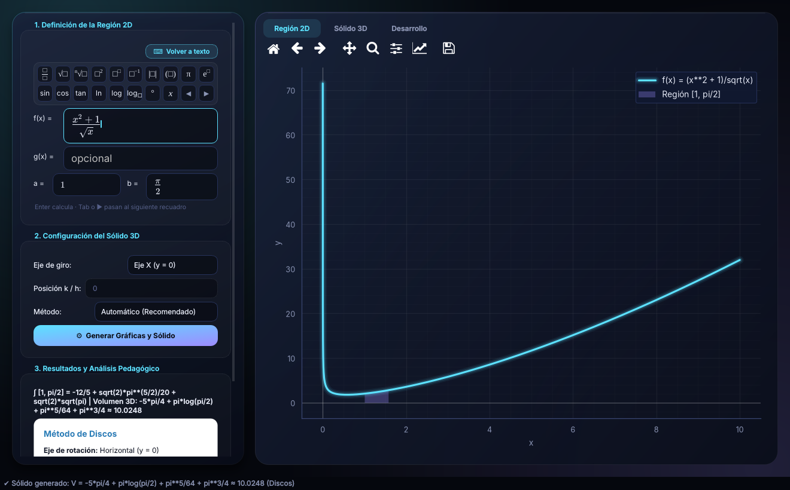
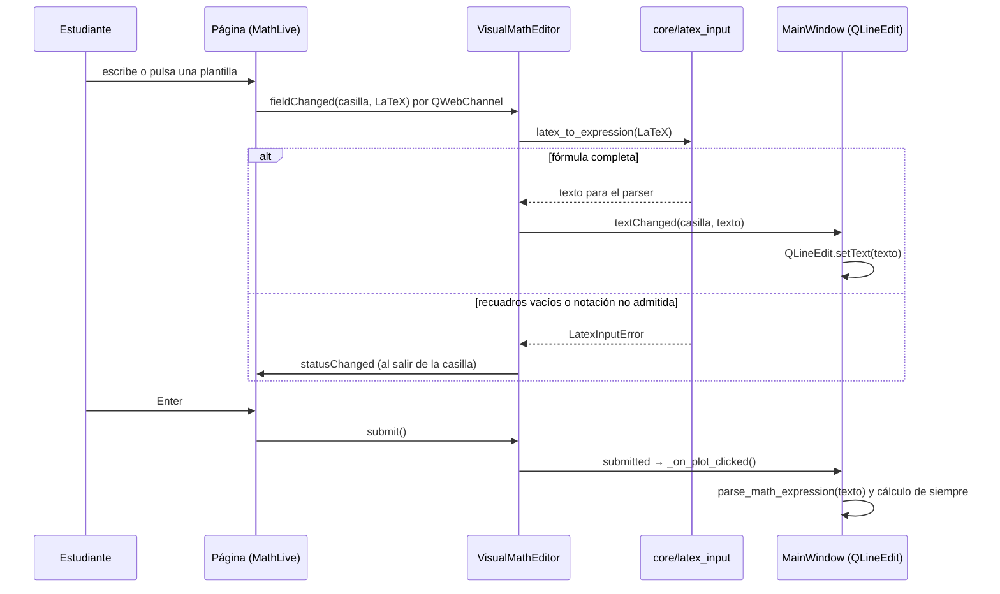

# Editor visual de fórmulas

El botón **«√x Editor visual»** del grupo «1. Definición de la Región 2D» cambia las casillas de texto por un editor donde la fracción dibuja su raya, la raíz su signo y la potencia su exponente, como en GeoGebra o en una calculadora con «Natural Display». Al pulsarlo otra vez («⌨ Volver a texto») vuelven las casillas de texto con lo mismo que se escribió. La aplicación recuerda el modo elegido para la próxima vez.



*Editor visual con f(x) = (x² + 1)/√x, a = 1 y b = π/2; el resultado y la gráfica se calcularon desde el editor.*

## Uso

### Barra de plantillas

Cada botón inserta una plantilla en la casilla que tenga el cursor. Los recuadros vacíos (□) se llenan escribiendo; Tab o ▶ pasan al siguiente.

| Botón | Inserta | Equivale en texto |
| --- | --- | --- |
| □/□ | Fracción | `(a)/(b)` |
| √□ | Raíz cuadrada | `sqrt(a)` |
| ⁿ√□ | Raíz n-ésima | `root(a, n)` |
| □² | Al cuadrado | `a**2` |
| □^□ | Potencia | `a**n` |
| □⁻¹ | Inversa: sobre `sin` da arcoseno; sobre un número, 1/x | `asin(x)`, `x**(-1)` |
| \|□\| | Valor absoluto | `Abs(a)` |
| (□) | Paréntesis | `(a)` |
| π | Pi | `pi` |
| e^□ | Exponencial | `exp(a)` |
| sin, cos, tan | Función con paréntesis | `sin(a)` |
| ln | Logaritmo natural | `log(a)` |
| log | Logaritmo en base 10 | `log(a, 10)` |
| log□ | Logaritmo con base | `log(a, b)` |
| ° | Grados | `a*pi/180` |
| x | La variable | `x` |
| ◀ ▶ | Mover el cursor (salir de un denominador o exponente) | — |

### Teclado

| Se escribe | Resultado |
| --- | --- |
| `/` | Fracción: lo anterior pasa al numerador |
| `^` | Exponente |
| `sqrt` | Raíz cuadrada |
| `sen`, `tg`, `arcsen`, `senh` | sin, tan, arcsin, sinh (atajos en español) |
| `sin`, `cos`, `ln`, `log`, `pi` | La función o la constante |
| `*` | Multiplicación (se muestra como ·) |
| Tab, ▶ | Siguiente recuadro |
| Enter | Calcula, igual que «Generar Gráficas y Sólido» |

### Convenciones (las de la calculadora y la clase)

| Notación | Significado |
| --- | --- |
| `log x` sin base | Logaritmo en base 10 |
| `ln x` | Logaritmo natural |
| `sin 2x` | sin(2x): el argumento es todo el producto que sigue |
| `x sin x cos x` | x · sin(x) · cos(x): otra función corta el argumento |
| `sin² x` | (sin x)² |
| `sin⁻¹ x` | Arcoseno |
| `30°` | 30 · π/180 = π/6 |
| `2x`, `x(x+1)` | Multiplicación implícita |
| `e` sola | La constante de Euler |
| `0,5` | 0.5 (coma decimal) |
| `(0,1),(1,2),…` | Lista de puntos para interpolación, como en el modo texto |

**Diferencia con el modo texto:** en texto, `log(x)` es el logaritmo natural (convención de SymPy). Para que no haya confusión, al pasar del texto al editor visual el logaritmo natural se muestra como `ln`.

### Avisos

| Aviso bajo la casilla | Qué hacer |
| --- | --- |
| «Completa los recuadros vacíos de la fórmula.» | Quedó un □ sin llenar. |
| «Falta el argumento de sin.» | La función no tiene a qué aplicarse. |
| «La fórmula usa «\int», que todavía no se admite.» | Integrales, sumatorias y matrices no se escriben en estas casillas. |
| «Escribe solo la expresión, sin el signo igual.» | Quitar `y =` o `f(x) =`. |
| «Este texto no es una expresión válida; corrígelo aquí.» | Lo que había en el modo texto no se pudo mostrar como fórmula. |

Los avisos de «recuadro vacío» aparecen al salir de la casilla, no mientras se escribe. Si una casilla está incompleta, «Generar» no calcula y la barra de estado indica cuál es.

## Cómo funciona

### Archivos

| Archivo | Papel |
| --- | --- |
| `integrallab/core/latex_input.py` | Traduce el LaTeX del editor a la sintaxis del parser (`latex_to_expression`) y el texto a LaTeX (`expression_to_latex`). Solo transforma cadenas; no ejecuta nada. |
| `integrallab/ui/widgets/visual_input.py` | `VisualMathEditor`: `QWebEngineView` con la página del editor y un puente `QWebChannel`. |
| `integrallab/resources/visual_input/index.html`, `visual_input.js`, `visual_input.css` | Página local: cuatro casillas `<math-field>` (f, g, a, b), barra de plantillas, atajos en español y tema oscuro. |
| `integrallab/resources/mathlive/` | MathLive 0.111.1 (`mathlive.min.js`) y fuentes KaTeX, sin conexión. Licencias en `THIRD_PARTY_NOTICES.md`. |
| `integrallab/ui/main_window.py` | Botón `visual_input_button`, sincronización con las `QLineEdit` y preferencia guardada. |
| `integrallab/ui/theme.py` | Estilo `QPushButton#ModeToggle`. |
| `tests/test_latex_input.py` | 98 pruebas del traductor, incluida la ida y vuelta texto → LaTeX → texto. |
| `tests/test_visual_input.py` | 8 pruebas de interfaz, incluida una de punta a punta que teclea `1/x` en MathLive real y calcula el sólido. |

### Flujo



### Reglas de diseño

- **Las `QLineEdit` siguen siendo el modelo.** El editor escribe en ellas el texto ya traducido; el resto de la ventana (cálculo, método disponible, pruebas existentes) no sabe que existe el editor.
- **Toda entrada pasa por el parser seguro.** El LaTeX nunca se evalúa: se traduce a texto y `parse_math_expression` aplica la lista blanca, la validación del árbol sintáctico y los límites de tamaño, igual que con lo escrito a mano.
- **La UI no usa SymPy.** La conversión texto → LaTeX vive en `core/latex_input.py`.
- **Casilla incompleta = último texto válido.** Mientras hay recuadros vacíos no se emite `textChanged`; la `QLineEdit` conserva la última versión completa y el cálculo se bloquea con el aviso.
- **Sin eco.** Lo que el editor escribe en una `QLineEdit` no vuelve al editor (`_syncing_visual`). Lo que la aplicación escribe por código (por ejemplo, los límites que rellena una interpolación) sí llega al editor.
- **Creación diferida.** El `QWebEngineView` se crea al activar el modo por primera vez: abrir la aplicación no paga el arranque del motor web.
- **Ranuras enlazadas, no lambdas.** Las `QLineEdit` se conectan a un método y la casilla se identifica con `sender()`. Una lambda que captura `self` crea un ciclo de referencias que Python libera al cerrar, después de `QApplication`, y el proceso terminaba con un aborto de memoria.
- **Panel desplazable.** El panel lateral está dentro de un `QScrollArea`: con el editor activo, o en pantallas de 768 px de alto, el contenido no cabe y antes Qt comprimía las casillas por debajo de su mínimo.

### Puente Python ↔ JavaScript

| Dirección | Nombre | Uso |
| --- | --- | --- |
| JS → Python | `ready(nombres)` | La página y MathLive están listos. |
| JS → Python | `fieldChanged(casilla, latex)` | Cambió una casilla. |
| JS → Python | `fieldCommitted(casilla)` | La casilla perdió el foco: mostrar su aviso, si hay. |
| JS → Python | `submit()` | Enter. |
| JS → Python | `contentHeight(px)` | Alto del contenido, para ajustar la vista sin barras de desplazamiento. |
| Python → JS | `setLatexRequested(casilla, latex)` | Cargar una fórmula (sin disparar `fieldChanged`). |
| Python → JS | `statusChanged(casilla, mensaje)` | Mostrar u ocultar el aviso. |
| Python → JS | `focusRequested(casilla)` | Poner el cursor. |

La página también expone `window.IntegralLabInput` (`setLatex`, `setStatus`, `focusField`, `getLatex`) para depuración y pruebas.

### Preferencia guardada

Se guarda con `QSettings` en formato INI, clave `input/visual_editor`:

| Sistema | Archivo |
| --- | --- |
| Windows | `%APPDATA%\IntegralLab\IntegralLab.ini` |
| Linux y macOS | `~/.config/IntegralLab/IntegralLab.ini` |

Las pruebas redirigen `QSettings` a una carpeta temporal (`tests/conftest.py`), así que nunca leen ni modifican la configuración real.

### Seguridad

- La página solo carga archivos locales del paquete; no hay peticiones de red.
- El puente expone cinco métodos que reciben cadenas; ninguno ejecuta código.
- `latex_to_expression` limita la entrada a 2.000 caracteres y rechaza cualquier comando que no esté en su tabla.

## Pruebas

```bash
pytest tests/test_latex_input.py tests/test_visual_input.py
```

Las pruebas de interfaz se omiten solas si falta QtWebEngine. En contenedores que se ejecutan como root, Chromium exige desactivar su sandbox:

```bash
QT_QPA_PLATFORM=offscreen QTWEBENGINE_DISABLE_SANDBOX=1 \
QTWEBENGINE_CHROMIUM_FLAGS="--no-sandbox --disable-gpu" pytest
```

## Actualizar MathLive

1. Descargar la versión nueva sin instalarla: `npm pack mathlive@<versión>` y descomprimir el `.tgz`.
2. Copiar `package/mathlive.min.js` a `integrallab/resources/mathlive/` y `package/fonts/*.woff2` a `integrallab/resources/mathlive/fonts/`. Los sonidos no se usan.
3. Copiar `package/LICENSE.txt` como `integrallab/resources/mathlive/LICENSE_MATHLIVE.txt` y actualizar la versión en `THIRD_PARTY_NOTICES.md` y en este documento.
4. Ejecutar las pruebas. `tests/test_visual_input.py::test_real_typing_in_mathlive_computes_the_solid` comprueba con MathLive real que el teclado, las fracciones y Enter siguen funcionando; si MathLive cambió el LaTeX que emite, falla `tests/test_latex_input.py`.

## Limitaciones conocidas

- Necesita QtWebEngine. Si no está, el botón aparece deshabilitado con el motivo en su ayuda emergente; si la página no carga en 20 s, la ventana vuelve al modo texto.
- No admite integrales, sumatorias, matrices, texto ni subíndices (salvo la base del logaritmo).
- En modo texto siguen los problemas de interpretación descritos en `docs/AUDITORIA_2026-10-24.md` (hallazgo M5).
- No hay teclado virtual en pantalla: la barra de plantillas cumple ese papel.
